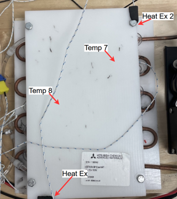
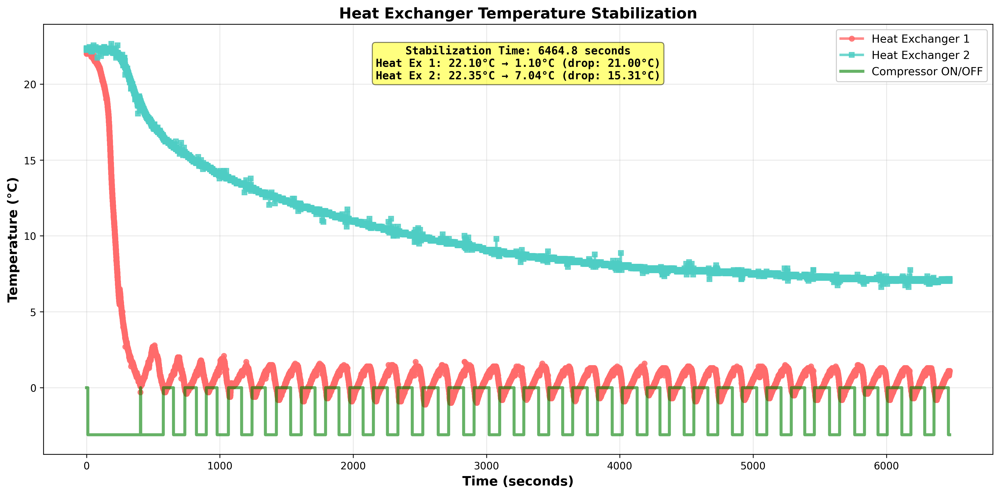

# Cooling plate time

**Date:** 2026-06-16  
**Goal:** Simple cooldown check — how long does the cooling plate / heat exchanger take to come down, and how are temperatures distributed?

## Protocol

1. Instrument the cooling plate (Temp 7, Temp 8 on the plate surface; Heat Ex / Heat Ex 2 at the exchanger).
2. Leave the peristaltic pump **off**.
3. Run the compressor and log sensors until the heat exchanger looks stable (~1.8 h).
4. Raw log: `raw_data/sensor_log_20260616_092249.csv`.

## Setup

Alluminium plate over copper cooling coils. Sensor locations as labeled below.

Notes from the run:

- CSF / CSF 2 looked unreliable.
- Temp 7 and Temp 8 may have been pressed too hard into the plate.
- Peristaltic pump off for the whole log.

## Results

Heat-exchanger cooldown from the log (`output_data/heat_exchanger_stabilization.png`):

| Channel | Start | End | ΔT |
|---------|-------|-----|----|
| Heat Ex 1 | 22.1 °C | 1.1 °C | −21.0 °C |
| Heat Ex 2 | 22.4 °C | 7.0 °C | −15.3 °C |

Stabilization time ≈ **6465 s (~1.8 h)**. Heat Ex 1 drops quickly then cycles with the compressor; Heat Ex 2 cools more slowly and levels near ~7 °C.

Plate surface sensors (Temp 7 / 8) started ~36 °C and ended ~20 / 16 °C — useful only as a rough spatial check given the mounting note above.

## Conclusion

- The cold side (Heat Ex 1) reaches near 0 °C in a few minutes and then holds via compressor cycling.
- Heat Ex 2 and the plate surface take much longer (~1–2 h) to settle — expect slow thermal mass on the plate side.
