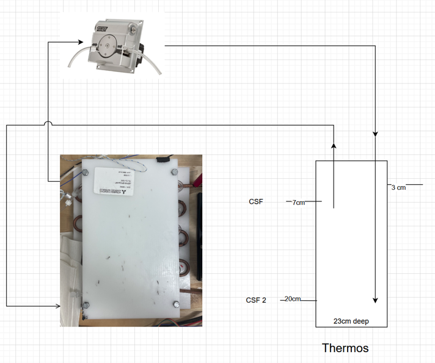
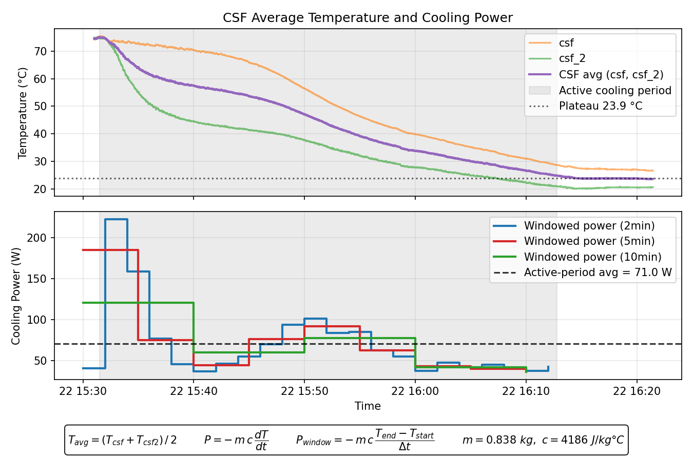
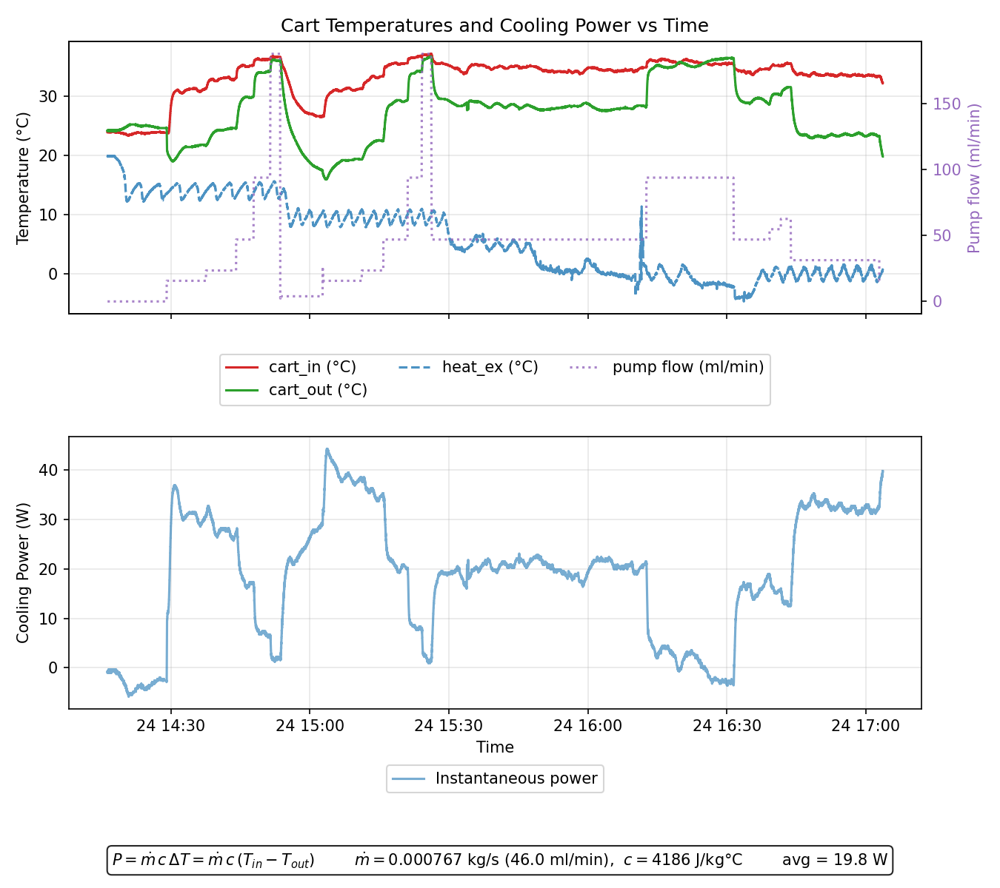

# Calorimetric cold plate

**Date:** 2026-06-22 / 2026-06-24  
**Goal:** Measure cooling power delivered from the cold plate into a warm thermos of water, and check how pump speed and cartridge routing affect it.

## Protocol

1. **Test 1 — hot-start cooldown** (`sensor_log_20260622_153100.csv`): cold plate ≈ −5 °C, thermos start ≈ 75 °C, pump **60 rpm**.
2. **Test 2 — flow sweep** (`sensor_log_20260624_141620.csv`): vary pump speed (~20–120 rpm) at moderate tank temperature.
3. **Test 3 — cartridge / plate check** (`sensor_log_20260624_092838.csv`): second hot-start run (~73 °C); plate ran warmer (~0 °C). Cartridge inlet/outlet routing was also changed during this day.

Notes: thermocouples were **uncalibrated**. Tank mass **0.838 kg**, \(c = 4186\) J/kg·°C. Flow for 60 rpm taken as ≈ **46 ml/min** (from pump calibration).

## Setup

Thermos → pump → cold plate / cartridge → return to thermos. CSF / CSF 2 are tank sensors at different depths.



## Results

**Tank calorimetry** (`exp2_calorimetry.py`): \(P = m\,c\,\Delta T / \Delta t\) over the auto-detected active cool-down (peak temp → 98% of drop to plateau).

**Flow calorimetry** (`exp2_temp_diff.py`): \(P = \dot{m}\,c\,(T_\mathrm{in}-T_\mathrm{out})\).

| Run | Condition | \(P_\mathrm{tank}\) | \(P_\mathrm{flow}\) |
|-----|-----------|---------------------|---------------------|
| 2026-06-22 | Plate ≈ −5 °C, 60 rpm, 75 → 25 °C in 41 min | **71 W** | **67 W** |
| 2026-06-24 AM | Plate ≈ 0 °C, 60 rpm, 73 → 24 °C in 57 min | **50 W** | **39 W** |



Flow sweep (2026-06-24 afternoon) — flow power from cart ΔT and pump calibration:

| RPM | ≈ Flow | Typical \(P_\mathrm{flow}\) |
|-----|--------|-----------------------------|
| 20–30 | 16–24 ml/min | ~11–18 W |
| 40–60 | 31–47 ml/min | ~16–22 W |
| 120 | ~94 ml/min | ΔT collapses; inferred power unreliable |



## Conclusion

- With the plate near **−5 °C** and 60 rpm, the loop removes about **70 W** from the thermos; tank and flow methods agree within a few watts.
- A warmer plate (~0 °C) drops that to ~**40–50 W**.
- Raising pump speed from ~20 → 60 rpm helps a little; at **120 rpm** cart ΔT shrinks so flow power is not trustworthy without better sensor placement / calibration.
- Follow-up: calibrated thermocouples and clearer cartridge in/out labeling (see later cartridge calorimetry runs).

```bash
python exp2_calorimetry.py
python exp2_temp_diff.py
```
