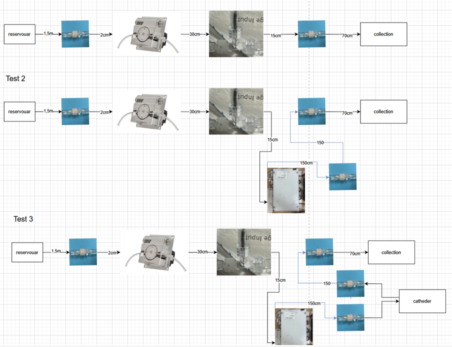
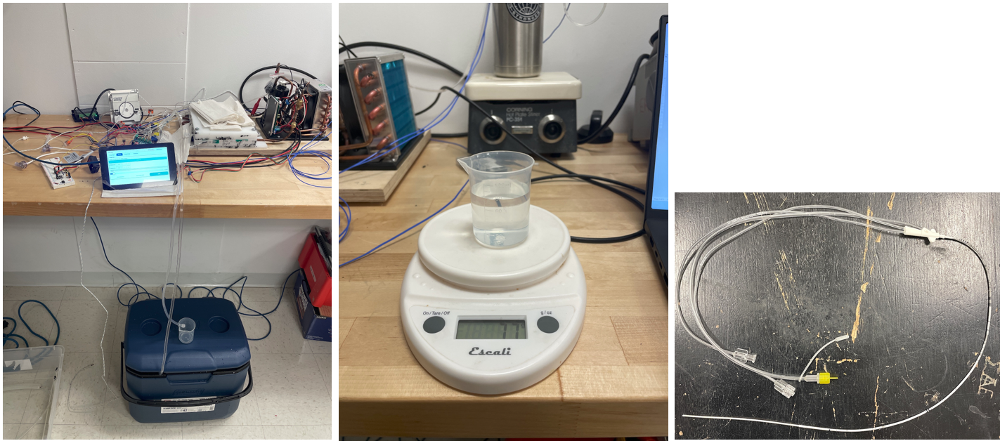
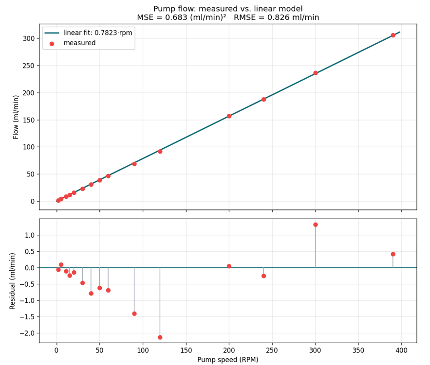

# Pump speed vs flow rate

**Date:** 2026-06-22  
**Goal:** Calibrate Watson-Marlow peristaltic pump set speed (RPM) against gravimetric flow, and check whether tubing diameter steps / catheter routing change the speed→flow relationship.

## Protocol

1. Bench setup: Watson-Marlow 400 ST/RXMD draws water (~19 °C) from a reservoir and discharges into a collection vessel on a kitchen scale.
2. Purge air from the tubing; run briefly until flow is steady and continuous.
3. For each speed setpoint: run **exactly 2.0 min**, weigh collected mass, dry/re-tare the vessel between runs.
4. Repeat a condition when useful; average repeats.
5. Sweep configurations (same gravimetric method each time):
   - **Test 1** — primary tubing only (no diameter step, no heat exchanger, no catheter)
   - **Test 2** — reduction onto a second (smaller) tube
   - **Test 3** — catheter on the primary tubing path

Flow from mass (water ≈ 1.0 g/ml): \(Q\ [\mathrm{ml/min}] = m\ [\mathrm{g}] / t\ [\mathrm{min}]\). With \(t = 2\) min: \(Q = m / 2\).

## Setup

Hardware: reservoir → flexible tubing → peristaltic pump → discharge to collection on scale. Timing via phone stopwatch; mass via kitchen scale.

Schematic of the three tubing layouts:

Bench photos (pump, scale, fittings):

## Results

Linear fit through the origin (primary configuration):

\[
Q\ [\mathrm{ml/min}] \approx 0.7823 \cdot \mathrm{RPM}
\]

| Metric | Value |
|--------|-------|
| Slope (through origin) | **0.7823 ml/min per rpm** |
| Example | 60 rpm → ≈ 47 ml/min |
| Fit error | RMSE ≈ 0.83 ml/min (MSE ≈ 0.68) |
| Speed range covered | ~0–400 rpm |

Configuration checks:

| Test | Change vs Test 1 | Finding |
|------|------------------|---------|
| 1 | Baseline tubing | Highly linear speed↔flow |
| 2 | Diameter reduction | No meaningful difference |
| 3 | Catheter on path | Small difference only |

This slope is the `ML_PER_MIN_PER_RPM = 0.7823` constant reused in later experiments (pressure / flow characterisation).

## Conclusion

- Pump delivery is linear enough that a single ml/min-per-rpm factor is fine for converting set speed to flow.
- Downstream diameter steps and the catheter do not materially change that calibration for this tubing set — flow is pump-dominated.
- Residuals stay within ~±2 ml/min across the sweep; use the linear model unless a higher-precision recalibration is needed (see `20260804_Pump_speed_vs_flowrate` for a follow-up gravimetric sweep).
