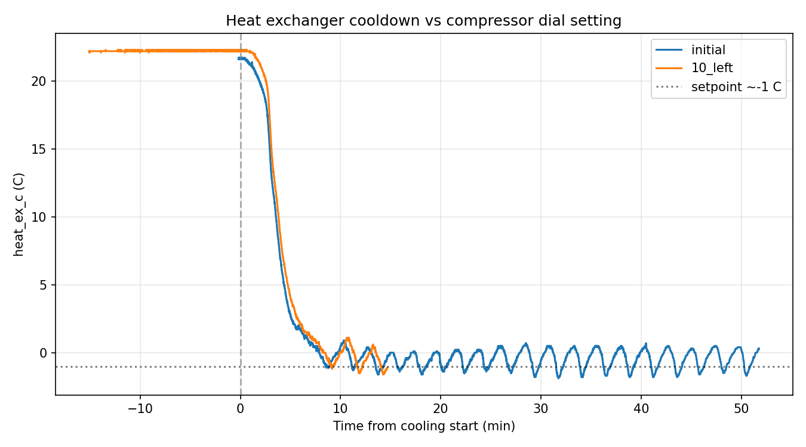
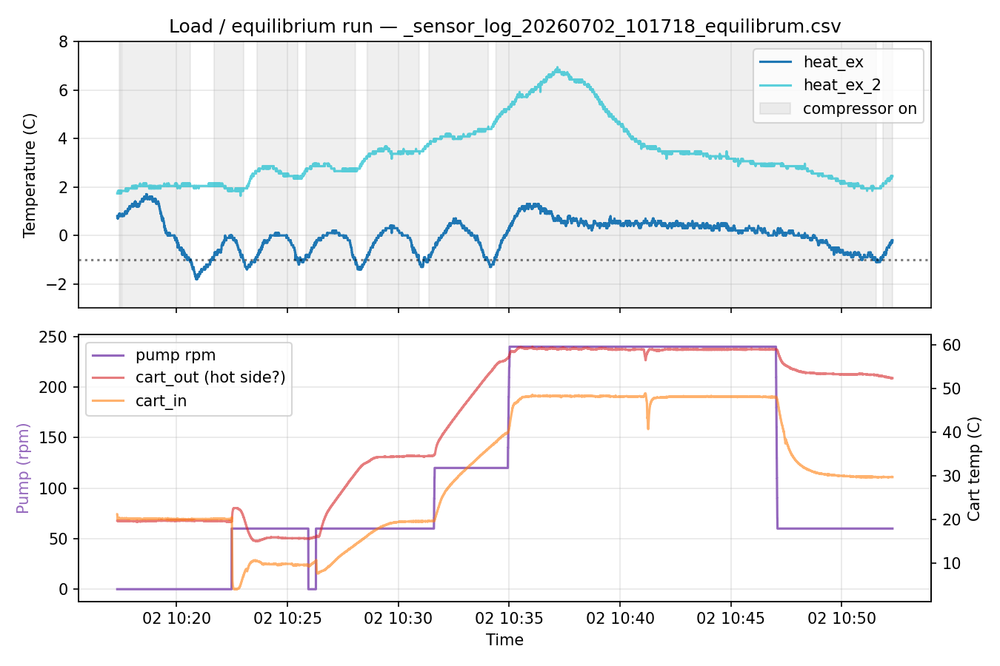

# Compressor speed characterisation

**Date:** 2026-06-30 / 2026-07-02  
**Goal:** Find which compressor dial settings actually cool the heat exchanger, and whether a warm water load can force continuous compressor operation near the −1 °C setpoint.

## Protocol

Temperature band used for on/off control: **−0.9 °C on**, **−1.0 °C off**, with a **60 s** wait after the last switch-off before allowing another on.

Compressor dial sweeps (manual; **not logged** in the CSV):

| Dial | Result (lab notes) |
|------|--------------------|
| −20 | Stays off |
| −18 | Turns on, then cuts out before reaching setpoint |
| −17 | Cools; usable baseline for load tests |
| −10 (left) | Cools from room temp |
| −10 → 0 → +20 → +40 → +80 | Little visible change in `heat_ex` once already near setpoint |
| +50 | Tried for highest speed |

Load forcing (dial ≈ −17): pump warm/hot water at 60 → 120 → 240 rpm so the compressor stays on continuously; then drop pump to 60 rpm and let the −1 °C band recover.

**Note:** `cart_in` / `cart_out` sensors were swapped on this day.

## Logs

| File | What it is |
|------|------------|
| `sensor_log_20260630_085357_initial.csv` | First cooldown characterisation |
| `sensor_log_20260702_091920_10_left.csv` | Dial **−10 left**, pump off |
| `_sensor_log_20260702_101718_equilibrum.csv` | Load / equilibrium run (pump 60–240 rpm) |

## Results

Cooldown from ~22 °C (`plot_heat_ex_all.py`, aligned at longest compressor-on start):

| Run | Time to `heat_ex` ≤ −1 °C | End duty (last ~10 min) |
|-----|---------------------------|-------------------------|
| initial (2026-06-30) | **~8.5 min** | ~0.73 |
| −10 left (2026-07-02) | **~9.1 min** | ~0.86 |

Both settle near the −1 °C band and cycle. Curves look similar — dial is above the “won't run” threshold in both cases.



Load run (already near 0 °C; pump heat applied):

- 60 → 120 rpm: still mostly cycling around −1…0 °C  
- **240 rpm** with hot return water: compressor **stays on** continuously; `heat_ex` sits slightly above the off band (~0…+0.7 °C)  
- Drop pump back to **60 rpm**: setpoint −1 °C recovered in a few minutes  
- Lab notes: compressor case ~55 °C max; copper tubing slowly frosting under heavy load



## Conclusion

- Dial must be **≳ −17** (roughly); −20 / −18 do not hold cooling.
- Once running, further dial increases (−10…+80) barely change logged `heat_ex` — the thermostat band dominates.
- Continuous compressor-on needs a real heat load (hot water + high pump speed); 240 rpm worked here.
- Compressor speed itself is not in the sensor log, so quantitative speed↔capacity curves need a logged setpoint or a better proxy.

```bash
python plot_heat_ex_all.py
```
