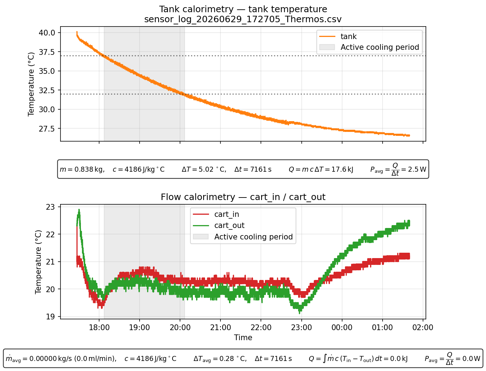
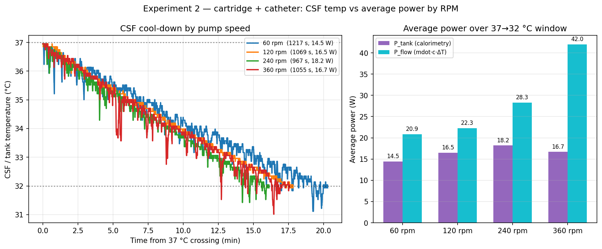
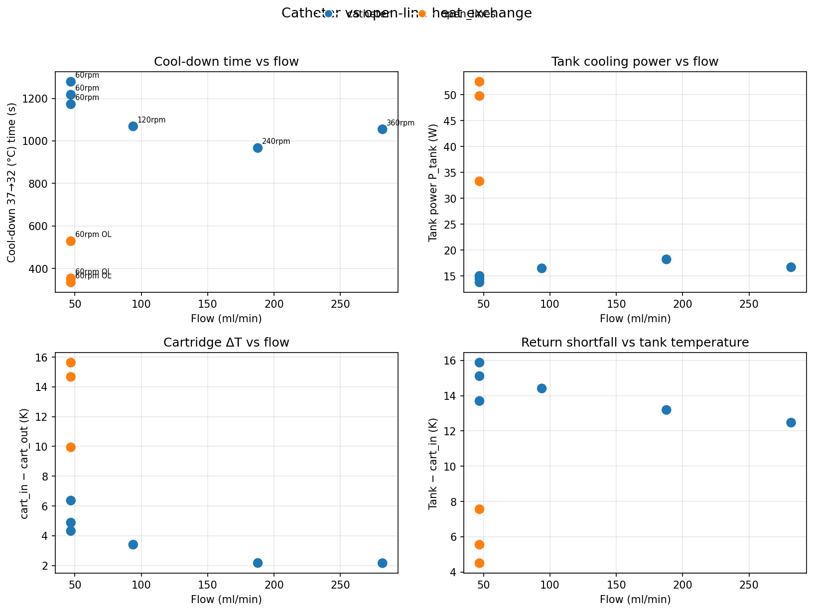

# Experiment 2 — Calorimetric test of cartridge prototype 1

**Date started:** 2026-06-22 (runs through 2026-07-27)  
**Author:** Patryk Prezyna  
**Goal:** Measure how much cooling power the Formlabs Clear Resin V5 cartridge prototype can deliver when rejecting heat from a warm CSF / water tank, and compare tank calorimetry with flow calorimetry across pump speeds and loop configurations.

---

## Setup

| Parameter | Value |
|-----------|-------|
| Thermos / tank water mass | **0.838 kg** |
| Loop water (incl. cartridge) | ~100 ml |
| Cartridge internal volume | ~37.5 ml |
| Cartridge material | Formlabs Clear Resin V5, *k* ≈ 0.56 W/m·K |
| Active analysis window | Tank cool-down **37 → 32 °C** |
| Specific heat used | *c* = 4186 J/kg·°C |

**Cooling sources tested**

- Passive thermos (no active cold source)
- Cold plate set to **0 °C**
- Ice bucket (with catheter in loop)
- Baseline / “no cooling” run (pump on, no intentional cold sink)

**Loop configurations**

- Single cartridge + catheter
- Single cartridge with **open lines** (catheter bypassed)
- **2× cartridge** (series), with and without open lines
- “White cart” variant (2026-07-17 afternoon run)

**Sensors / analysis** (`exp2_calorimetry.py`)

1. **Tank calorimetry:** \(P_\mathrm{tank} = m\,c\,\Delta T / \Delta t\) over the 37→32 °C window  
2. **Flow calorimetry:** \(P_\mathrm{flow} = \dot{m}\,c\,(T_\mathrm{in}-T_\mathrm{out})\) integrated over the same window (`cart_in`/`cart_out`, or `cath_in`/`cath_out`)

Pump speed tags use `rmp` in filenames (typo for **rpm**). Approximate flows: **60 rpm ≈ 47 ml/min**, **120 ≈ 94**, **240 ≈ 188**, **360 ≈ 282**.

---

## File naming

| Pattern | Meaning |
|---------|---------|
| `sensor_log_YYYYMMDD_HHMMSS_<condition>.csv` | Raw sensor log |
| `calorimetry_YYYYMMDD_HHMMSS_<condition>.png` | Paired tank + flow calorimetry plot |
| `*_Thermos` | Passive heat-loss baseline (no cold plate) |
| `*_cold_plate_*_0C` | Cold plate at 0 °C |
| `*_NNrmp*` | Pump speed (rpm) |
| `*_open_lines*` | Catheter removed / open tubing |
| `*_2xCart*` / `*_2xcart*` | Two cartridges in series |
| `*_ice_bucket_with_catheder*` | Ice bucket as cold source, catheter in loop |
| `*_no_cooling_*` | Pump circulating, no intentional cooling |
| `compare_rpm_csf_power.png` | Overlay of 60–360 rpm catheter runs |
| `catheter_analysis/` | Extra catheter vs open-lines metrics & ladders |
| `archive/` | Older / superseded logs |

---

## Results (37 → 32 °C window)

Powers below are recomputed with the same method as the plots. Prefer **\(P_\mathrm{tank}\)** as the net cooling delivered to the CSF tank; **\(P_\mathrm{flow}\)** is the heat picked up across the cartridge (can differ when sensors were swapped, lines exchange heat with room, or the cold source is not the cartridge).

### Baselines

| Run | Condition | \(P_\mathrm{tank}\) | \(P_\mathrm{flow}\) | Notes |
|-----|-----------|---------------------|---------------------|-------|
| 2026-06-29 | Thermos only | **2.5 W** | 0.0 W | Passive heat leak of the thermos (~2.5 W); flow ≈ 0 |
| 2026-07-27 | No cooling, 60 rpm | **6.3 W** | (unreliable) | Room ~21.7 °C; cath sensors failed mid-run |



### Cold plate @ 0 °C (early runs; note sensor swap)

Meeting notes: *“the certify in and out were switched.”* Flow sign is therefore inverted on these two logs.

| Run | RPM | \(P_\mathrm{tank}\) | \(\|P_\mathrm{flow}\|\) |
|-----|-----|---------------------|-------------------------|
| 2026-07-01 | 60 | **14.2 W** | 24.4 W |
| 2026-07-01 | 120 | **17.6 W** | 31.7 W |

### Cartridge + catheter — RPM sweep (2026-07-16)



| RPM | Flow | Δt | \(P_\mathrm{tank}\) | \(P_\mathrm{flow}\) |
|-----|------|----|---------------------|---------------------|
| 60 | 47 ml/min | 1217 s | **14.5 W** | 20.9 W |
| 120 | 94 ml/min | 1069 s | **16.5 W** | 22.3 W |
| 240 | 188 ml/min | 967 s | **18.2 W** | 28.3 W |
| 360 | 282 ml/min | 1055 s | **16.7 W** | 42.0 W |

Tank cooling peaks near **240 rpm (~18 W)** and drops slightly at 360 rpm, while cartridge flow power keeps rising — consistent with more heat exchange in the tubing / less effective delivery to the tank at high flow.

### Open lines & dual cartridge (2026-07-16)

| Run | Config | \(P_\mathrm{tank}\) | \(P_\mathrm{flow}\) |
|-----|--------|---------------------|---------------------|
| 60 rpm open lines | 1× cart, no catheter | **33.3 W** | 32.7 W |
| 60 rpm 2× cart open lines | 2× cart | **49.7 W** | 47.9 W |
| 60 rpm 2× cart open lines v2 | 2× cart | **52.5 W** | 50.9 W |
| 60 rpm 2× cart (with catheter) | 2× cart | **15.3 W** | 32.0 W |

Removing the catheter roughly **doubles** single-cart tank power (~14 → 33 W). A second cartridge on open lines pushes tank power to **~50 W**. With the catheter back in the loop, tank power falls back toward the single-cart range even with 2× carts — the catheter remains the bottleneck.



### Ice bucket + catheter (2026-07-17)

| Run | RPM | \(P_\mathrm{tank}\) | \(P_\mathrm{flow}\) |
|-----|-----|---------------------|---------------------|
| Ice bucket + catheter | 60 | **18.3 W** | 41.6 W |
| Ice bucket + catheter | 120 | **28.5 W** | 61.2 W |

### White cartridge (2026-07-17)

| Run | Condition | \(P_\mathrm{tank}\) | \(P_\mathrm{flow}\) |
|-----|-----------|---------------------|---------------------|
| `sensor_log_20260717_142931` | White cart, 60 rpm | **17.5 W** | 32.5 W |

---

## Conclusions

1. **Passive thermos leak ≈ 2.5 W** — any “system” cooling figure should be interpreted relative to this background.
2. With cold plate / ice cooling and a catheter in the loop, **net tank cooling is typically ~14–18 W at 60–120 rpm**, up to **~28 W** (ice bucket @ 120 rpm). That is **far below** earlier modeling that suggested ~200 W capability for a 0 °C catheter inlet.
3. **Higher pump speed does not always increase tank cooling.** \(P_\mathrm{tank}\) rose from 60→240 rpm then fell at 360 rpm, while \(P_\mathrm{flow}\) kept increasing — heat is still exchanged in the cartridge/lines but less of it shows up as CSF tank cool-down.
4. **The catheter dominates the thermal resistance.** Open lines give ~33 W (1×) / ~50 W (2×); putting the catheter back in collapses performance toward ~15 W even with two cartridges.
5. Early cold-plate logs had **in/out sensors swapped**; use absolute flow power carefully on those two runs.

---

## Scripts

| Script | Role |
|--------|------|
| `exp2_calorimetry.py` | Process each `sensor_log_*.csv` → `calorimetry_*.png` |
| `compare_rpm_csf_power.py` | Overlay 60–360 rpm catheter runs |
| `catheter_heat_exchange_analysis.py` | Catheter vs open-lines UA / ladder plots → `catheter_analysis/` |

```bash
python exp2_calorimetry.py
python compare_rpm_csf_power.py
```
