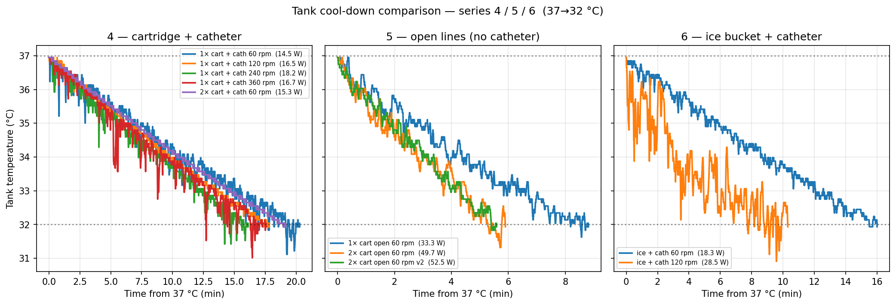
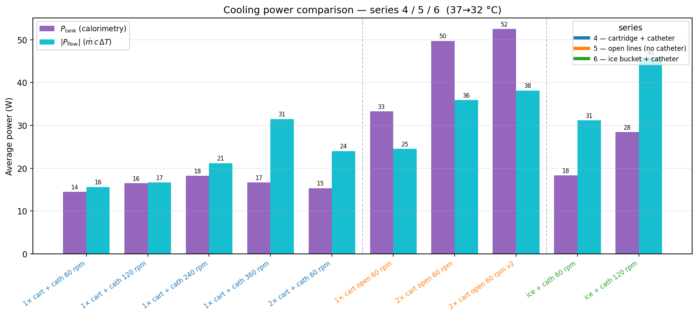
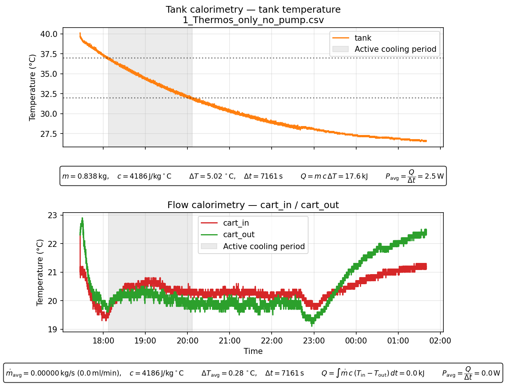
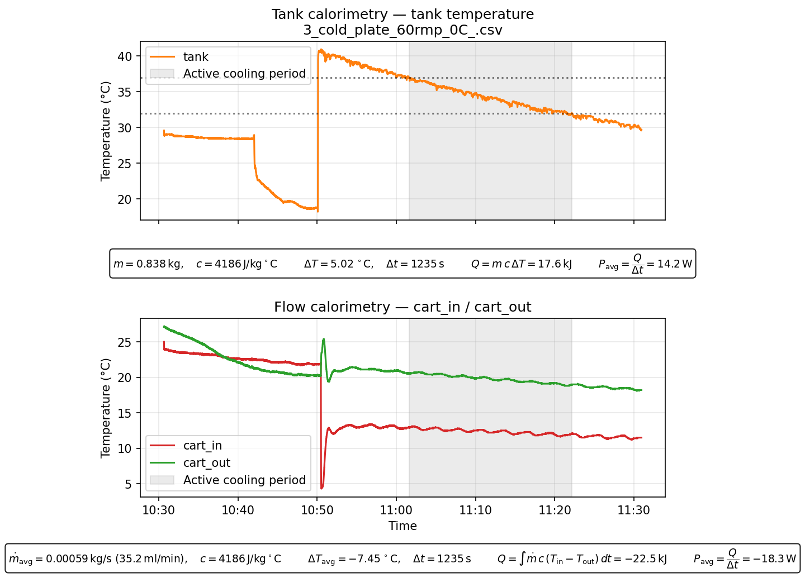
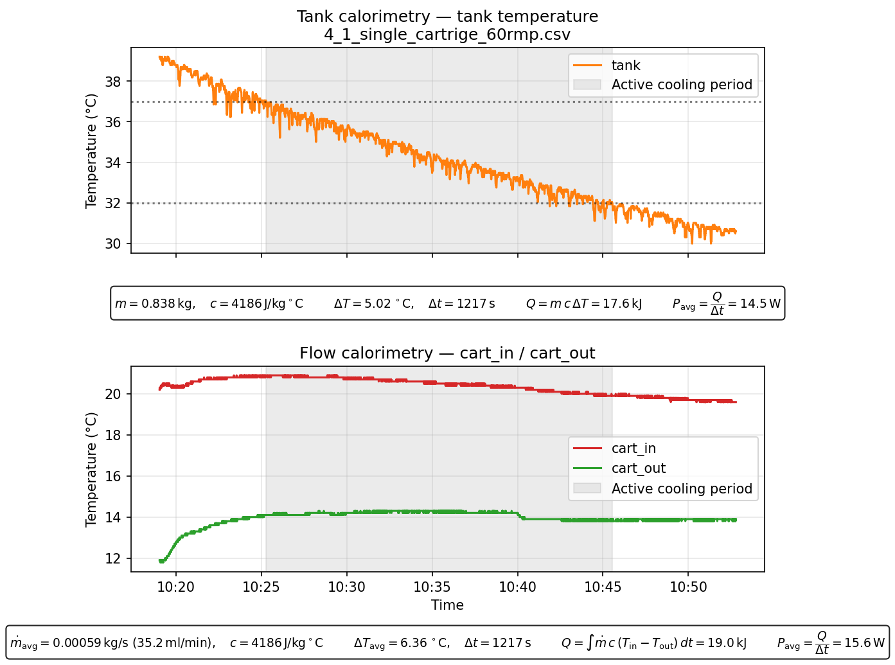
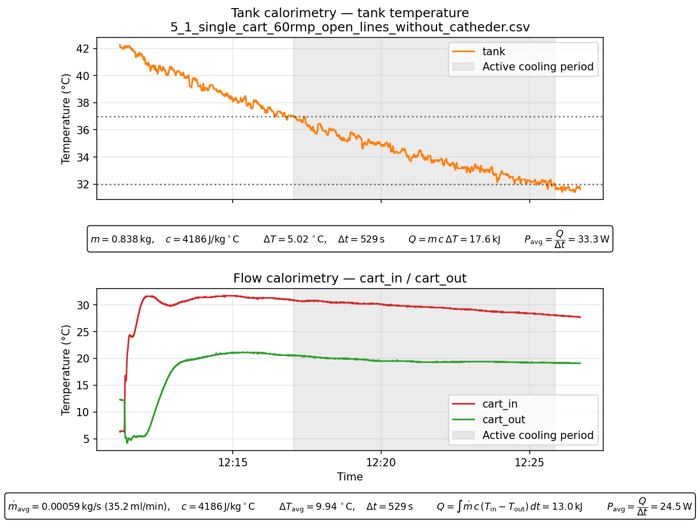
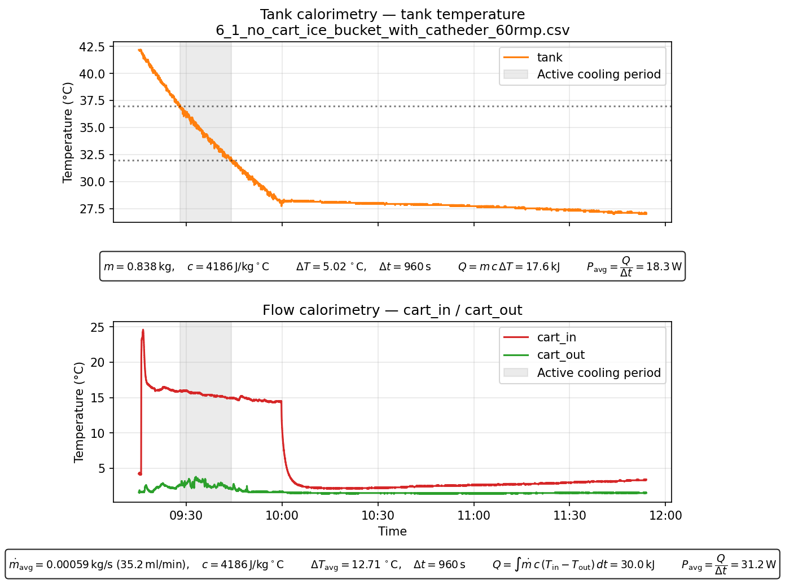

# Experiment — Calorimetric heat characterisation (cartridge prototype 1)

**Date started:** 2026-06-22 (runs through 2026-07-27)  
**Author:** Patryk Prezyna  
**Goal:** Characterise the Formlabs Clear Resin V5 cartridge prototype for heat transfer — how large should the cartridge be, and what limits cooling delivery to the CSF tank?

---

## Setup

| Parameter | Value |
|-----------|-------|
| Thermos / tank water mass | **0.838 kg** |
| Loop water (incl. cartridge) | ~100 ml |
| Cartridge internal volume | ~37.5 ml |
| Cartridge material | Formlabs Clear Resin V5, *k* ≈ 0.56 W/m·K |
| Active analysis window | Tank cool-down **37 → 32 °C** |
| Specific heat used | *c* = 4186 J/kg·°C |

**Cooling sources tested**

| Series | Condition |
|--------|-----------|
| 1 | Passive thermos (no pump, no cold source) |
| 2 | Thermos + tubing @ 60 rpm, no cartridge / no cooling |
| 3 | Cold plate set to **0 °C** |
| 4 | Single cartridge across RPM; also 2× cartridge in series (with catheter) |
| 5 | Cartridge on open lines (no catheter) |
| 6 | Ice bucket (catheter in loop, no cartridge) |

**Power methods**

1. **Tank calorimetry:** \(P_\mathrm{tank} = m\,c\,\Delta T / \Delta t\) over the 37→32 °C window  
2. **Flow calorimetry:** \(P_\mathrm{flow} = \dot{m}\,c\,(T_\mathrm{in}-T_\mathrm{out})\) integrated over the same window (`cart_in`/`cart_out`, or `cath_in`/`cath_out`)

Prefer **\(P_\mathrm{tank}\)** as the net cooling delivered to the CSF tank. **\(P_\mathrm{flow}\)** is the heat picked up across the cartridge / cold section (can differ when sensors were swapped, lines exchange heat with room, or the catheter is the bottleneck).

---

## Cross-series comparison (4 / 5 / 6)

Overlay of tank cool-downs (aligned at the 37 °C crossing) and side-by-side average powers:





Open lines (series 5) cool the tank roughly **2–3× faster** than the same cartridge with a catheter. Ice bucket + catheter (series 6) sits between cold-plate/cartridge-with-catheter and open-line performance.

Regenerate with:

```bash
python compare_series_4_5_6.py
```

---

## Results (37 → 32 °C window)

### 1–2 · Baselines

| Run | Condition | \(P_\mathrm{tank}\) | \(P_\mathrm{flow}\) | Notes |
|-----|-----------|---------------------|---------------------|-------|
| `1_Thermos_only_no_pump` | Thermos only | **2.5 W** | ~0 W | Passive heat leak of the thermos |
| `2_Thermos_and_tubing_no_cooling_60rmp` | No cooling, 60 rpm | **6.3 W** | (n/a) | Room ~21.7 °C; cath sensors failed mid-run |



### 3 · Cold plate @ 0 °C

Meeting notes: *“the certify in and out were switched.”* Flow sign is therefore inverted on these two logs — use **\|P_flow\|**.

| Run | RPM | \(P_\mathrm{tank}\) | \|P_flow\| |
|-----|-----|---------------------|------------|
| `3_cold_plate_60rmp_0C_` | 60 | **14.2 W** | 24.4 W |
| `3_cold_plate_120rmp_0C` | 120 | **17.6 W** | 31.7 W |



### 4 · Cartridge + catheter — RPM sweep (and 2× cart)

| Run | RPM | Flow | Δt | \(P_\mathrm{tank}\) | \(P_\mathrm{flow}\) |
|-----|-----|------|----|---------------------|---------------------|
| `4_1_single_cartrige_60rmp` | 60 | 47 ml/min | 1217 s | **14.5 W** | 20.9 W |
| `4_2_single_cartrige_120rmp` | 120 | 94 ml/min | 1069 s | **16.5 W** | 22.3 W |
| `4_3_single_cartrige__240rmp` | 240 | 188 ml/min | 967 s | **18.2 W** | 28.3 W |
| `4_4_single_cartrige_360rmp` | 360 | 282 ml/min | 1055 s | **16.7 W** | 42.0 W |
| `4_5_2x_cart_60rmp_v1` | 60 | 47 ml/min | 1147 s | **15.3 W** | 32.0 W |

Tank cooling peaks near **240 rpm (~18 W)** and drops slightly at 360 rpm, while cartridge flow power keeps rising — more heat exchange in the tubing / less effective delivery to the tank at high flow. A second cartridge **with the catheter still in** barely helps (~15 W).



### 5 · Open lines (no catheter)

| Run | Config | \(P_\mathrm{tank}\) | \(P_\mathrm{flow}\) |
|-----|--------|---------------------|---------------------|
| `5_1_single_cart_60rmp_open_lines_without_catheder` | 1× cart, no catheter | **33.3 W** | 32.7 W |
| `5_2_2x_cart_60rmp_open_lines_without_catheder` | 2× cart | **49.7 W** | 47.9 W |
| `5_2_2x_cart_60rmp_open_lines_without_catheder_v2` | 2× cart (repeat) | **52.5 W** | 50.9 W |

Removing the catheter roughly **doubles** single-cart tank power (~14 → 33 W). A second cartridge on open lines pushes tank power to **~50 W**. With the catheter back in (series 4, `4_5`), tank power collapses toward the single-cart range — the catheter remains the bottleneck. On open lines, \(P_\mathrm{tank}\) ≈ \(P_\mathrm{flow}\).



### 6 · Ice bucket + catheter

| Run | RPM | \(P_\mathrm{tank}\) | \(P_\mathrm{flow}\) |
|-----|-----|---------------------|---------------------|
| `6_1_no_cart_ice_bucket_with_catheder_60rmp` | 60 | **18.3 W** | 41.6 W |
| `6_1_no_cart_ice_bucket_with_catheder_120rmp` | 120 | **28.5 W** | 61.2 W |



### White cartridge (2026-07-17)

| Run | Condition | \(P_\mathrm{tank}\) | \(P_\mathrm{flow}\) |
|-----|-----------|---------------------|---------------------|
| `sensor_log_20260717_142931` | White cart, 60 rpm | **17.5 W** | 32.5 W |

---

## Conclusions

1. **Passive thermos leak ≈ 2.5 W** — interpret any “system” cooling figure relative to this background.
2. With cold plate / ice cooling and a catheter in the loop, **net tank cooling is typically ~14–18 W at 60–120 rpm**, up to **~28 W** (ice bucket @ 120 rpm). That is far below earlier modeling that suggested ~200 W for a 0 °C catheter inlet.
3. **Higher pump speed does not always increase tank cooling.** \(P_\mathrm{tank}\) rose from 60→240 rpm then fell at 360 rpm, while \(P_\mathrm{flow}\) kept increasing.
4. **The catheter dominates the thermal resistance.** Open lines give ~33 W (1×) / ~50 W (2×); putting the catheter back in collapses performance toward ~15 W even with two cartridges.
5. Early cold-plate logs had **in/out sensors swapped**; use absolute flow power carefully on those two runs.

---

## Scripts

| Script | Role |
|--------|------|
| `analyze_cooling_window_calorimetry.py` | Process each `raw_data/*.csv` → `output_data/<stem>.png` |
| `compare_series_4_5_6.py` | Overlay + bar comparison for series **4 / 5 / 6** → `output_data/compare_series_4_5_6_*.png` |
| `plot_thermos_power_20260717_091508.py` | Older single-run thermos helper (archived workflow) |

```bash
python analyze_cooling_window_calorimetry.py
python compare_series_4_5_6.py
```
