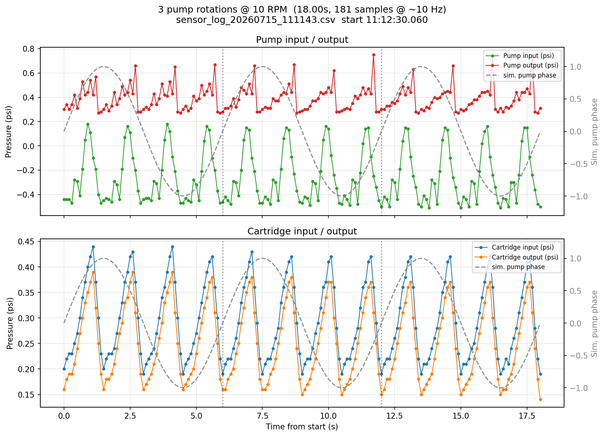
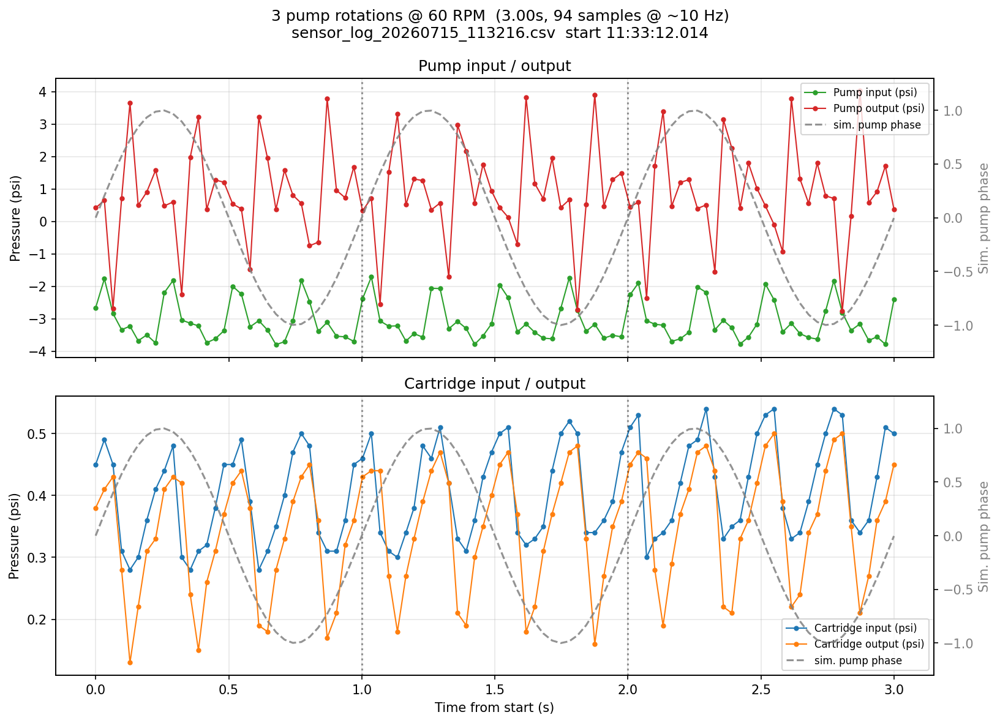
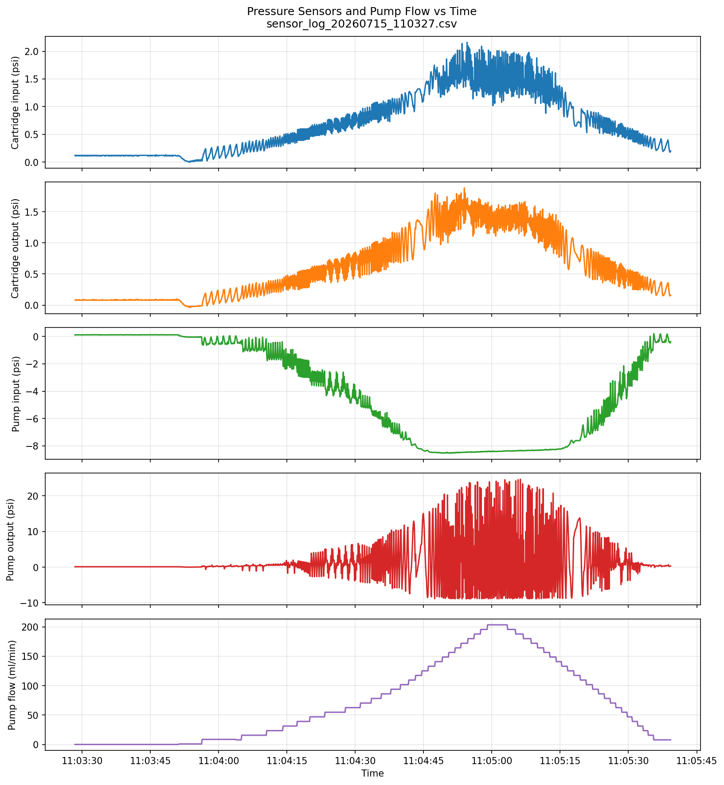

# Experiment 1 — Pressure sensors

**Date:** 2026-07-15  
**Goal:** Commission the four inline pressure sensors (cartridge in/out, pump in/out) and characterise how pressure and pulsation scale with peristaltic pump speed in the closed coolant loop.

## Protocol

1. Log the full sensor suite (~10 Hz) while stepping `peristaltic_pump_set_speed_rpm`.
2. Confirm polarity: pump inlet should go negative (suction), pump outlet should show positive discharge spikes, cartridge ports should sit between them with a small ΔP.
3. Capture short holds for an RPM sweep, then longer holds at fixed speed for pulsation / phase alignment.
4. Overlay a simulated shaft phase (1 cycle per revolution) on a few-rotation window to check that pressure peaks lock to the roller period.

## Setup

| Item | Detail |
|------|--------|
| Loop | Closed coolant circuit with cartridge + peristaltic pump |
| Pressure channels | `cartridge_input_psi`, `cartridge_output_psi`, `pump_input_psi`, `pump_output_psi` |
| Flow | `pump_flow_ml_per_s` (reported; ≈ 0.78 ml/min per rpm → 60 rpm ≈ 47 ml/min) |
| Sample rate | typically ~10 Hz (`110327`, `111143`); `113216` denser (~30 Hz); long hold `120635` ~4–5 Hz |

Raw logs live in `raw_data/`. Plots go to `output_data/`.

## Raw logs

| Log | Duration | What was done |
|-----|----------|---------------|
| `sensor_log_20260715_110327.csv` | ~2 min | Fast RPM sweep **0 → 260 → ~10** (short ~1–5 s holds) |
| `sensor_log_20260715_111143.csv` | ~1.5 min | 60 rpm hold (~22 s) then 10 rpm hold (~49 s) |
| `sensor_log_20260715_113216.csv` | ~1 min | 10 / 60 / 120 rpm holds (denser sampling) |
| `sensor_log_20260715_120635.csv` | ~37 min | Long **60 rpm** steady hold (~36 min) |

## Results

### Mean pressures vs speed (RPM sweep, `110327`)

Cartridge mean pressure rises roughly with flow; pump inlet vacuum deepens; pump outlet mean stays modest but the peaks grow.

| RPM | Flow (ml/min) | Cart in | Cart out | Pump in | Pump out |
|-----|---------------|---------|----------|---------|----------|
| 0 | 0 | 0.12 | 0.08 | 0.12 | 0.12 |
| 60 | 47 | 0.58 | 0.51 | −3.0 | 0.75 |
| 120 | 94 | 1.01 | 0.92 | −6.9 | 2.0 |
| 200 | 156 | 1.54 | 1.44 | −8.5 | 4.8 |
| 260 | 203 | 1.50 | 1.39 | −8.4 | 3.7 |

Across the cartridge, ΔP stays small (**~0.05–0.15 psi**). At high speed the pump inlet sits near **−8.5 psi** (suction limit / cavitation risk worth watching). Pump outlet **max** on this sweep reached **~25 psi**.

### Steady 60 rpm (long hold, `120635`)

Over ~36 min at 60 rpm / ~47 ml/min:

| Channel | Mean (psi) | Peak–peak (psi) |
|---------|------------|-----------------|
| Cartridge input | **0.40** | 0.71 |
| Cartridge output | **0.34** | 0.71 |
| Pump input | **−2.98** | 2.3 |
| Pump output | **0.83** | **8.2** |

Cartridge ΔP ≈ **0.06 psi**. Pump discharge is highly pulsatile; the cartridge damps most of that amplitude.

### Pulsation locked to shaft rotation

At 60 rpm, three-rotation windows show pump-outlet spikes repeating once per revolution; cartridge traces follow the same period at much lower amplitude (~0.3 psi swing).







## Conclusion

1. **Sensors look wired correctly** — suction on pump inlet, positive spikes on pump outlet, cartridge between them with a small drop.
2. **Cartridge hydraulic drop is tiny** at these flows (~0.06 psi at 60 rpm); the interesting dynamics are at the **pump**, especially outlet pulsation (peak–peak ~7–8 psi at 60 rpm).
3. **Pump inlet vacuum scales with speed** and reaches ~−8.5 psi by ~200 rpm on this loop — relevant for max usable RPM / cavitation.
4. Pulsation is **phase-locked to the peristaltic shaft**; 10 Hz logging is enough to see the period at 60 rpm, denser logging (`113216`) resolves the waveform better.

## Scripts

```bash
# Overview: all four pressures + flow vs time for every log in raw_data/
python plot_pressures.py

# Zoom: 3 pump rotations from a start time (writes to output_data/)
python plot_three_rotations.py sensor_log_20260715_111143.csv 11:12:04
python plot_three_rotations.py sensor_log_20260715_113216.csv 11:33:12
```

`plot_pressures.py` skips a CSV when its PNG already exists in `output_data/`; delete the PNG to regenerate.
