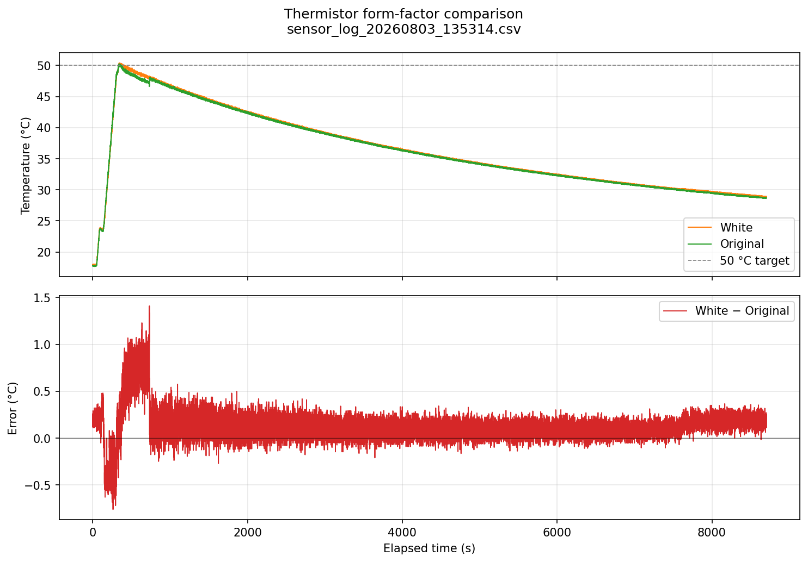

# Comparing thermistor form factors

**Date:** 2026-08-03  
**Goal:** Check whether `White` and `Original` thermistor form factors respond at the same speed when heated and cooled in the same water bath.

## Setup

Both sensors in the same water volume. Heat from room temperature (~18 °C) to **50 °C**, then cool down. Log: `sensor_log_20260803_135314.csv`.

## Results



**Both sensors have similar reaction times.** The traces overlap through heat-up and cool-down — no meaningful lag between form factors.

| | Finding |
|--|---------|
| Heat-up (~18 → 50 °C) | Both reach ~50 °C in ~5.6 min; threshold crossings differ by only **1–2 s** |
| Tracking | \|White − Original\| stays within ~**1 °C** on the rise |
| Cool-down | Traces remain aligned as the bath cools |

**Conclusion:** Form-factor differences do not meaningfully change response speed on this sweep. Either sensor is fine for tracking bath temperature changes.

## Script

```bash
python plot_thermistor_formfactors.py
```
