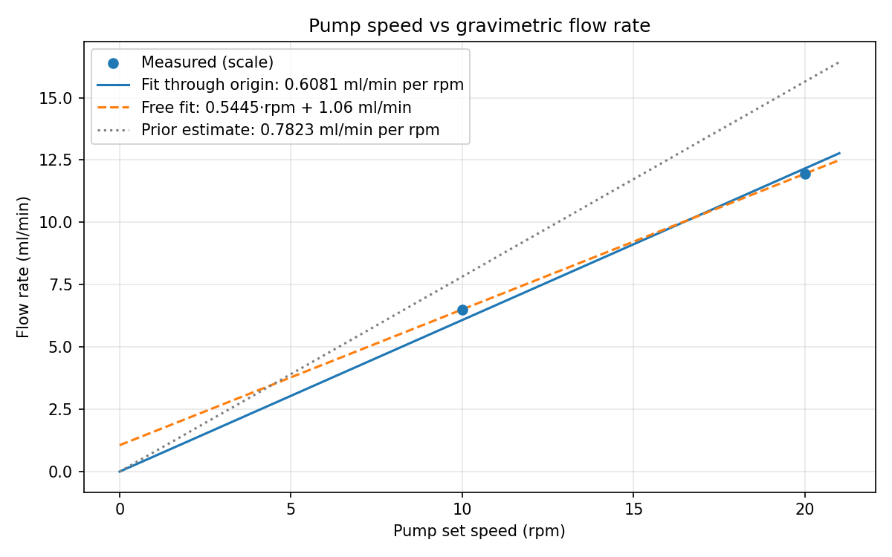

# Pump speed vs flow rate (gravimetric)

**Date:** 2026-08-04  
**Operator:**  
**Goal:** Calibrate peristaltic pump speed (RPM) against volumetric flow by collecting water for a fixed hold time and weighing it on a scale. Produces the ml/min-per-rpm factor used in other experiments.

## Protocol

1. Set up an open discharge: pump draws from a reservoir and delivers into a collection vessel on a scale (tare the vessel before each run).
2. Choose a set speed (RPM). Start the pump and collection together; run for **exactly 2.0 min** (some repeats used 5.0 min).
3. Stop the pump and collection together. Record the collected mass (g).
4. Empty / re-tare the vessel. Repeat at the next speed.
5. Suggested sweep (adjust as needed): **10–240 rpm** — one timed hold each.
6. Enter each run in `raw_data/gravimetric_runs.csv` (copy from the template if needed).

Flow rate from mass (water ≈ 1.000 g/ml at room temperature):

\[
Q\ [\mathrm{ml/min}] = \frac{m\ [\mathrm{g}]}{\rho\ [\mathrm{g/ml}] \cdot t\ [\mathrm{min}]}
\]

With \(\rho = 1.0\) g/ml and \(t = 2.0\) min: \(Q = m / 2\).

## Setup

- Peristaltic pump (set speed in RPM)
- Reservoir and tubing (same ID / routing as the intended use case)
- Collection vessel on a bench scale (resolution ≤ 0.1 g preferred)
- Stopwatch or timed hold (2.0 min)
- Optional: note tube size, fluid (water), and ambient temperature in the CSV `notes` column

Photo or schematic: place under `setup/`.

## Results

Run the analysis script after filling the CSV:

```bash
python plot_speed_vs_flow.py
```

- Plot: `output_data/pump_speed_vs_flowrate.png`
- Fit summary printed to the console (slope ≈ ml/min per rpm)

| Finding | Value |
|---------|-------|
| Adopted ml/min per rpm | **0.5862** |
| Through-origin fit (all holds) | 0.5801 ml/min per rpm |
| Free fit | 0.5778·rpm + 0.29 ml/min |
| Example | 60 rpm → ≈ **35 ml/min** |
| Prior estimate (2026-06-22) | 0.7823 ml/min per rpm |

The adopted constant is the mean \(Q/\mathrm{RPM}\) on the 2 min holds at ≤ 180 rpm (matches the ~0.586 slope used elsewhere in the repo).



## Conclusion

- Delivery is still linear enough for a single factor, but the true slope is **~25% lower** than the June estimate (0.7823 → 0.5862).
- This factor is **superseded** by the 2026-09-14 Tygon PVC + SAGE prototype 2 gravimetric sweep (`20260914_Pump_speed_vs_flowrate_Tygon_PVC`): **0.8034 ml/min per rpm** (60 rpm ≈ 48 ml/min). Use `Experiments.experiment_tools.ML_PER_MIN_PER_RPM`.
