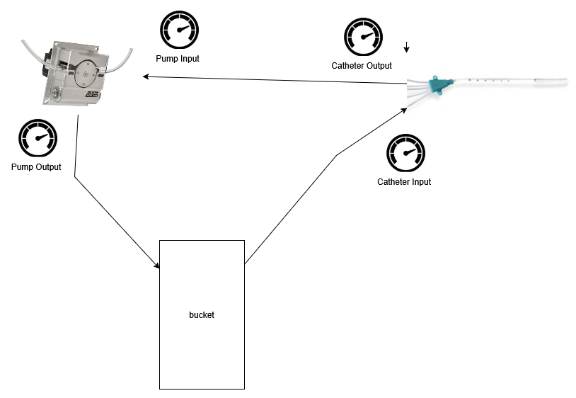
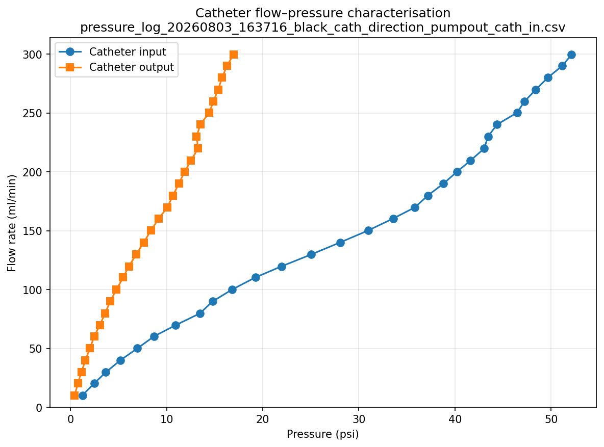
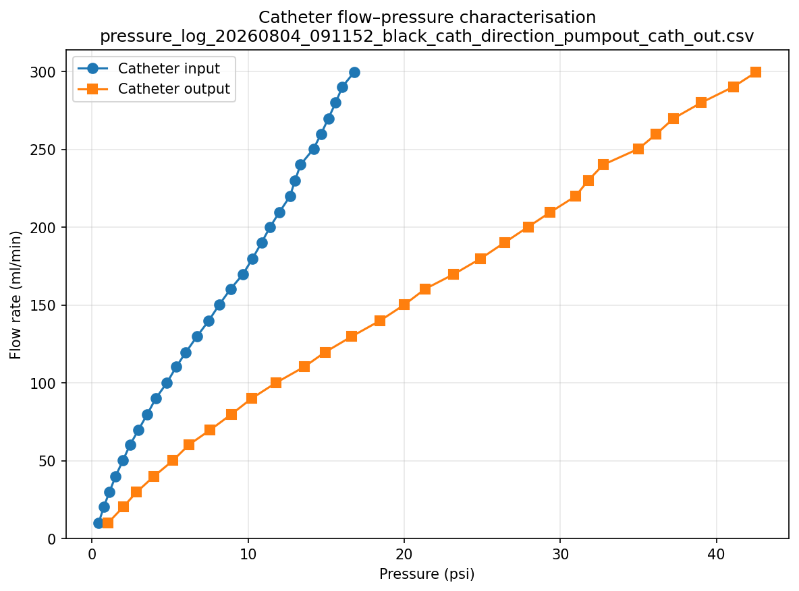

# Catheter flow–pressure characterisation (SAGE)

**Date:** 2026-08-05  
**Goal:** Characterise the catheter hydraulic resistance by sweeping flow rate from **10 → 100 ml/min** and recording **catheter input** and **catheter output** pressure. Run the sweep twice with **opposite catheter flow direction**, while the pump **always pushes**.

## Protocol

1. Build the closed loop: reservoir (bucket) ↔ catheter ↔ peristaltic pump. Keep the pump on the **discharge / push** side for both runs (do not switch to suction-through-catheter).
2. Log four pressures continuously:
   - `catheder_input_psi` / `catheder_output_psi` (primary)
   - `pump_input_psi` / `pump_output_psi` (loop diagnostics)
3. Step the pump so volumetric flow covers **~10–320 ml/min**. Hold each step long enough for a steady reading (~1–2 min).
4. Run once in each **catheter orientation** (pump always pushing):
   - **Forward** — flow enters the catheter input port and exits the catheter output port
   - **Reverse** — swap the catheter connections so flow enters the former output and exits the former input (sensors stay with their ports: what the log calls input/output follows the fittings)
5. Final deliverable: **pressure on X**, **flow rate (ml/min) on Y** — inlet, outlet for both orientations overlaid.

Pump speed ↔ flow uses the prior calibration **≈ 0.782 ml/min per rpm** (≈ 60 rpm → 47 ml/min). Target steps roughly:

| Flow (ml/min) | ≈ RPM |
|---------------|-------|
| 10 | 13 |
| 20 | 26 |
| 30 | 38 |
| 40 | 51 |
| 50 | 64 |
| 60 | 77 |
| 80 | 102 |
| 100 | 128 |

## Setup

Pump always drives flow into the loop (push). Between the two characterisation runs, only the **catheter inlet/outlet plumbing is swapped** so fluid travels the opposite way through the catheter; pump placement and push direction stay the same.

## Preliminary data black catheder

## Preliminary SAGE catheder

