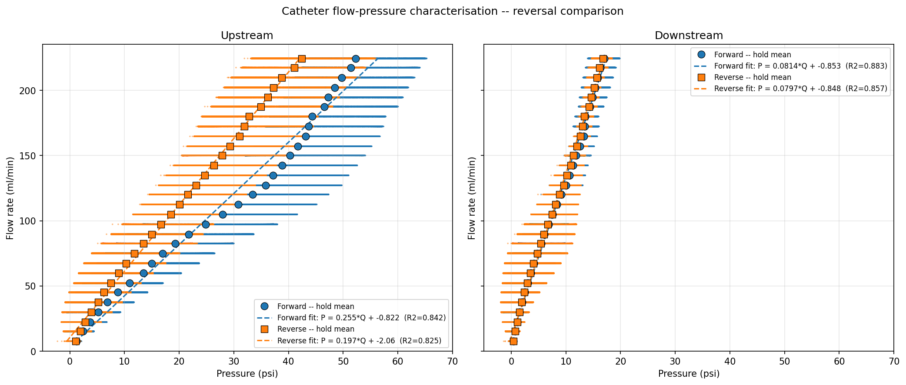

# Catheter flow–pressure characterisation (SAGE)

**Date:** 2026-08-05  
**Goal:** Characterise the catheter hydraulic resistance by sweeping flow rate from **10 → 100 ml/min** and recording **catheter input** and **catheter output** pressure. Run the sweep twice with **opposite catheter flow direction**, while the pump **always pushes**.

## Protocol

1. Build the closed loop: reservoir (bucket) ↔ catheter ↔ peristaltic pump. Keep the pump on the **discharge / push** side for both runs (do not switch to suction-through-catheter).
2. Log four pressures continuously:
   - `catheder_input_psi` / `catheder_output_psi` (primary)
   - `pump_input_psi` / `pump_output_psi` (loop diagnostics)
3. Step the pump so volumetric flow covers **~10–320 ml/min**. Hold each step long enough for a steady reading (~1–2 min).
4. Run once in each **catheter orientation** (pump always pushing):
   - **Forward** — flow enters the catheter input port and exits the catheter output port
   - **Reverse** — swap the catheter connections so flow enters the former output and exits the former input (sensors stay with their ports: what the log calls input/output follows the fittings)
5. Final deliverable: **pressure on X**, **flow rate (ml/min) on Y** — inlet, outlet for both orientations overlaid.

**Connection mistake — do not edit `raw_data/`:** physically, catheter **input** (upstream) pressure must be **higher** than catheter **output** (downstream). If a log has `catheder_output_psi` > `catheder_input_psi`, the fittings / channels were swapped on the bench. That is the case for `pressure_log_20260804_091152_black_cath_direction_pumpout_cath_out.csv` (reverse black catheter: output > input on every RPM step). Leave the CSV as recorded. The plot scripts swap those two columns for figures only, and label the plot.

Never hand-edit `raw_data/`; regenerate analysis into `output_data/`.

Pump speed ↔ flow uses the 2026-08-04 gravimetric calibration **0.5862 ml/min per rpm** (≈ 60 rpm → 35 ml/min). The RPM steps below were planned against the older 0.782 factor; plotted flow rates are recomputed with the new constant:

| Target flow (old plan) | Set RPM | Actual flow (0.5862) |
|------------------------|---------|----------------------|
| 10 | 13 | ≈ 8 ml/min |
| 20 | 26 | ≈ 15 ml/min |
| 30 | 38 | ≈ 22 ml/min |
| 40 | 51 | ≈ 30 ml/min |
| 50 | 64 | ≈ 38 ml/min |
| 60 | 77 | ≈ 45 ml/min |
| 80 | 102 | ≈ 60 ml/min |
| 100 | 128 | ≈ 75 ml/min |

## Setup

Pump always drives flow into the loop (push). Between the two characterisation runs, only the **catheter inlet/outlet plumbing is swapped** so fluid travels the opposite way through the catheter; pump placement and push direction stay the same.

## Preliminary data black catheder

Forward log is oriented correctly (input > output). Reverse log is the **connection mistake** above; the reverse figure below is plotted with in/out swapped so blue = physical inlet and orange = physical outlet.

All timepoints visualized (what look like bars are actually just very many dots). Fit performed on pressure with respect to flow rate. Implies that outlet pressure is more derivative of resistance to flow to atmosphere (back to the bucket) whereas input pressure can detect flow rate based changes in the path geometry (perhaps a deflection of the lumen on input pressure). Seems like the input join is more distal than the output join... (Grace's vibes judgement)

## Preliminary SAGE catheder

