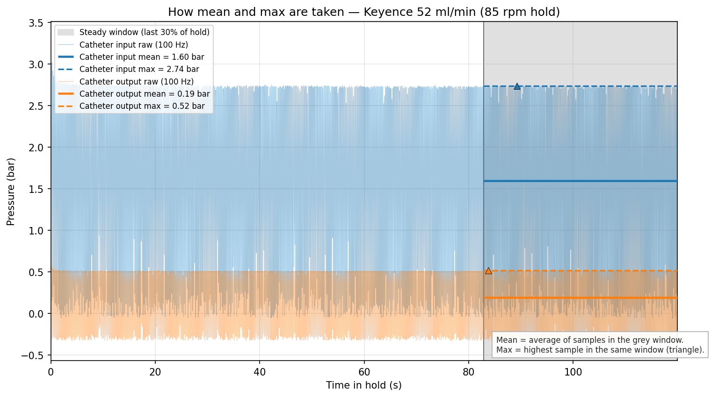
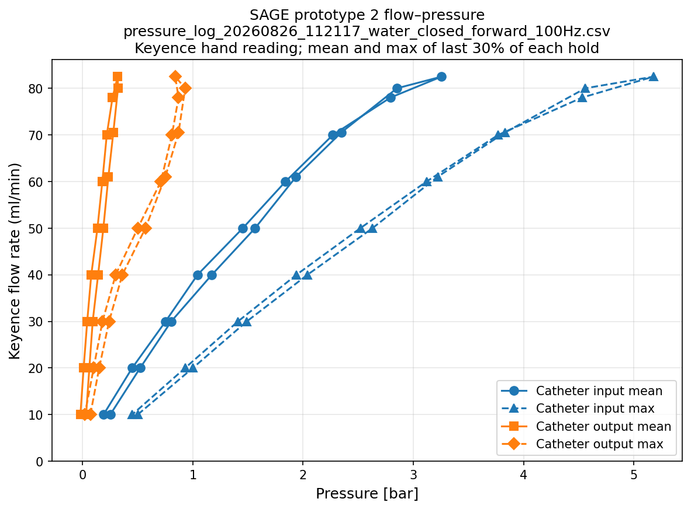
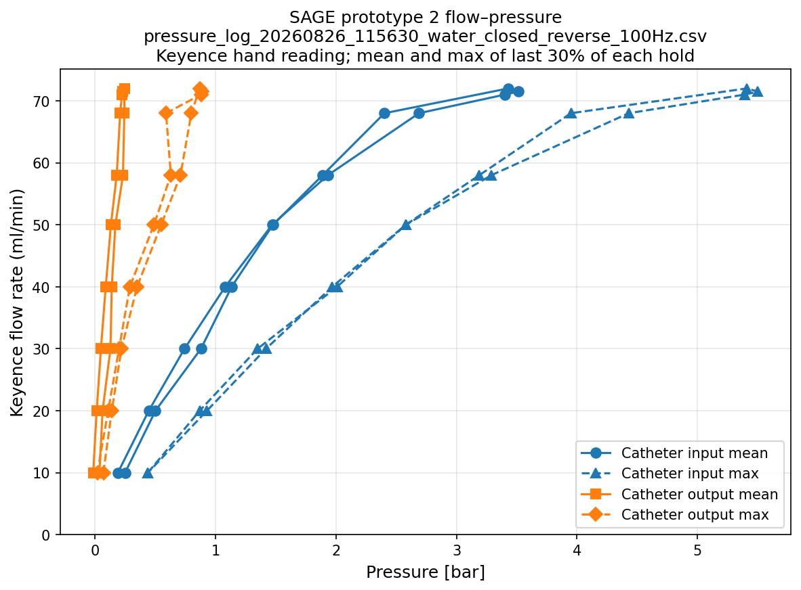

# Flow–pressure characterisation of SAGE prototype 2

**Date:** 2026-08-25  
**Operator:**  
**Goal:** Characterise the catheter hydraulic resistance by sweeping flow rate from **10 → 90 ml/min** and recording **catheter input** and **catheter output** pressure. Run the sweep twice with **opposite catheter flow direction**, while the pump **always pushes**.

## Protocol

1. Keep the pump on the **discharge / push** side for every run (do not switch to suction-through-catheter). Reverse the catheter between orientations. The sensors always show **where the fluid comes from and goes to**: catheter **input** = inlet, catheter **output** = outlet, so **input pressure is always bigger than output**.
2. Log four pressures continuously with 100 samples persecond:
   - `catheder_input_psi` / `catheder_output_psi` (primary)
   - `pump_input_psi` / `pump_output_psi` (loop diagnostics)
3. For each configuration below, step volumetric flow **10 → 90 → 10 ml/min**. Hold each step long enough for a steady reading (2 min). Repeat the sweep in the **opposite catheter flow direction**.
4. At each step, **read the external flow sensor by hand** (Keyence display) and note it in  
   `external_flow_log_YYYYMMDD_HHMMSS_<condition>.csv`  
   next to set flow / set RPM. This shows whether the **set flow is actually achieved** with this catheter/pump combination.
5. Run the three configurations **in this order**:
   1. **Water, open line**
   2. **Water, closed line**
   3. **Water, closed line, reverse direction**
   4. **Saline, closed line**
   5. **Saline, closed line, reverse direction**
6. One trio of logs per condition, same timestamp and `<condition>`:
   - `pressure_log_YYYYMMDD_HHMMSS_<condition>_100Hz.csv`
   - `sensor_log_YYYYMMDD_HHMMSS_<condition>.csv`
   - `external_flow_log_YYYYMMDD_HHMMSS_<condition>.csv`  
   `<condition>` = `{fluid}_{open|closed}_{forward|reverse}`, e.g. `water_open_forward`, `water_closed_forward`, `water_closed_reverse`, `saline_closed_forward`.
7. Final deliverable: **pressure on X**, **flow rate (ml/min) on Y** — catheter input (tab:blue) and output (tab:orange), same colours as `Experiments/20260805_Flow_Pressure_characterisiation_with_SAGE`.

Pump speed ↔ flow uses the 2026-08-04 gravimetric calibration **0.5862 ml/min per rpm** (≈ 60 rpm → 35 ml/min).


## Setup


## Results


Each flow step is held for ~2 min. For the plot we only use the **last 30%** of that hold (grey band): **mean** = average of those samples, **max** = the highest one. One example hold (50 ml/min, water open forward):

```bash
python plot_hold_raw.py
```




Water closed line, **forward** and **reverse** side by side:

| Closed forward | Closed reverse |
|----------------|----------------|
|  |  |

**Water, open line, forward** (`20260825_143605`):  
`raw_data/pressure_log_20260825_143605_water_open_forward_100Hz.csv`, `raw_data/sensor_log_20260825_143605_water_open_forward.csv`, `raw_data/external_flow_log_20260825_143605_water_open_forward.csv`.

**Water, closed line, forward** (`20260826_112117`):  
`raw_data/pressure_log_20260826_112117_water_closed_forward_100Hz.csv`, `raw_data/sensor_log_20260826_112117_water_closed_forward.csv`, `raw_data/external_flow_log_20260826_112117_water_closed_forward.csv`.

**Water, closed line, reverse** (`20260826_115630`):  
`raw_data/pressure_log_20260826_115630_water_closed_reverse_100Hz.csv`, `raw_data/sensor_log_20260826_115630_water_closed_reverse.csv`, `raw_data/external_flow_log_20260826_115630_water_closed_reverse.csv`.

Never hand-edit `raw_data/`; regenerate analysis into `output_data/`. Commit the final result figure(s) cited here; regenerate the rest locally.

## Conclusion

- What we learned
- Implications for the next design / test
- Open questions or follow-ups
