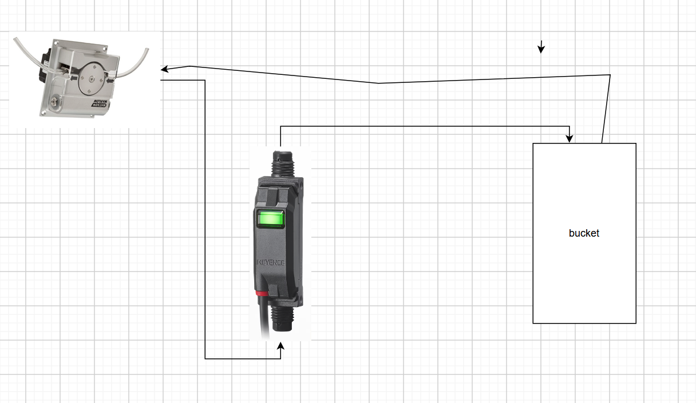
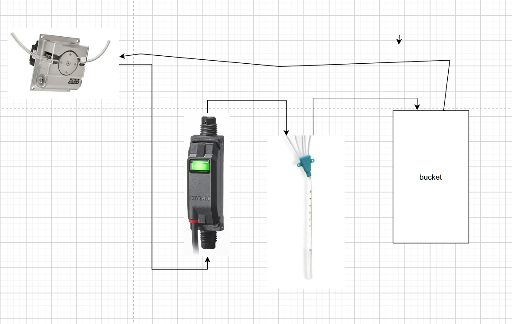
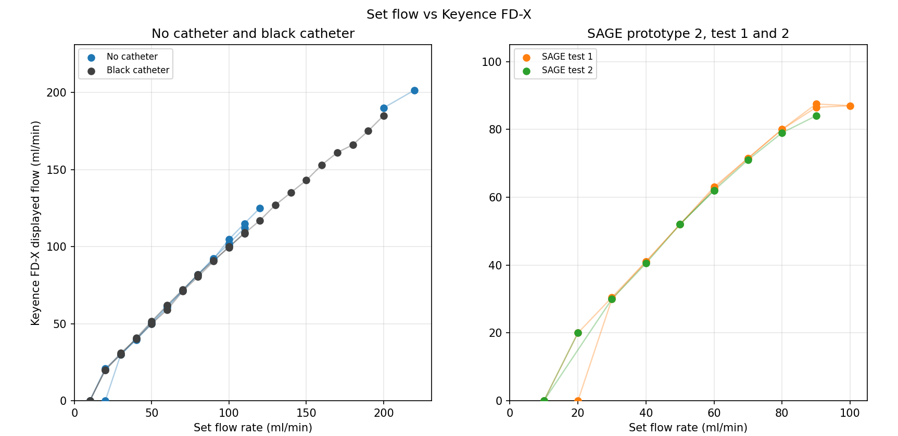

# Keyence FD-X flow-rate sensor evaluation

**Date:** 2026-08-25  
**Operator:**  
**Goal:** Initial evaluation of the Keyence FD-X flow-rate sensors using room-temperature water. Record the displayed flow rate while stepping 10 → 100 ml/min and back in 10 ml/min jumps, for three loop configurations (no catheter, black catheter, SAGE prototype 2).

## Protocol

1. Fill the loop with **room-temperature water**. No other fluids for this first evaluation.
2. Mount / plumb the Keyence FD-X in the flow path **upwards** (inlet at the bottom, outlet at the top; flow through the sensor is bottom → top). Note which display reading is logged (and which unit) in the CSV.
3. For each configuration below, step the pump so volumetric flow covers **10 → 100 ml/min** in **10 ml/min** jumps, then **100 → 10 ml/min** on the same grid (hysteresis check). Hold each step long enough for a stable display reading.
4. At each step, record the **displayed flow rate** in a CSV under `raw_data/`.
5. Repeat the full up/down sweep for three configurations, in this order:
   1. **No catheter** — open loop / bypass, no catheter in the path
   2. **Black catheter**
   3. **SAGE prototype 2** (new catheter)
6. Prefer one CSV per configuration, named  
   `sensor_log_YYYYMMDD_HHMMSS_<condition>.csv`  
   with `<condition>` one of `no_catheter`, `black_catheter`, `sage_prototype_2`.

## Setup

- Fluid: room-temperature water
- Sensor: Keyence FD-X, **positioned upwards** (inlet bottom, outlet top). Displayed flow rate logged by hand into CSV
- Pump: Watson-Marlow peristaltic pump
- Loop: bucket → pump → Keyence FD-X → (optional catheter) → bucket
- Configurations: no catheter → black catheter → SAGE prototype 2
- Setpoints: 10, 20, …, 100 ml/min up, then 90, 80, …, 10 ml/min down

### No catheter

Bucket → pump → Keyence FD-X (upward) → bucket.



### With catheter

Bucket → pump → Keyence FD-X (upward) → catheter → bucket. Used for the black catheter and SAGE prototype 2 runs.



## Results

```bash
python plot_set_vs_keyence.py
```



Left: no catheter and black catheter. Right: SAGE prototype 2, test 1 and test 2.

Mean absolute error (Keyence − set), all holds vs the 30–100 ml/min band:

| Config | n | MAE (all) | MAE (30–100) | Max Keyence |
|--------|---|-----------|--------------|-------------|
| No catheter | 31 | 3.5 ml/min | **1.3 ml/min** | 202 ml/min at 220 set |
| Black catheter | 31 | 3.7 ml/min | **0.9 ml/min** | 185 ml/min at 200 set |
| SAGE test 1 | 19 | 3.9 ml/min | 2.3 ml/min | **87.5 ml/min** at 90 set |
| SAGE test 2 | 12 | 3.0 ml/min | 1.8 ml/min | 84 ml/min at 90 set |

Raw logs: `raw_data/without_cathether.csv`, `raw_data/black_cathether.csv`, `raw_data/SAGE prototype 2.csv`, `raw_data/SAGE prototype 2_test2.csv`.

Never hand-edit `raw_data/`; regenerate analysis into `output_data/`. Commit the final result figure(s) cited here; regenerate the rest locally.

## Conclusion

- From **~30 ml/min** up, the FD-X tracks the 0.5862 ml/min-per-rpm set point closely for **no catheter** and the **black catheter** (MAE < 1.5 ml/min in the 30–100 band).
- Below **~20 ml/min** the display is often **0** and/or **red / blinking red** — treat that as below the useful range for this mounting, not as a true zero flow.
- **SAGE prototype 2** follows the others until ~80 ml/min, then **caps at ~87 ml/min** even at 100 set. The same pump/sensor still reads ~185–200 ml/min without a catheter or with the black one, so this is a **loop/catheter limit**, not an FD-X ceiling.
- Extra high-flow holds (no catheter to 220, black to 200) show growing **under-read vs set** as RPM increases.
- Repeat SAGE sweep (`_test2`) is incomplete but shows the same cap (~84 ml/min at 90 set).

Open: confirm whether the SAGE cap is catheter hydraulic resistance, leak/air, or a pump stall at that back-pressure; re-run test 2 with a full 10–100–10 grid.
