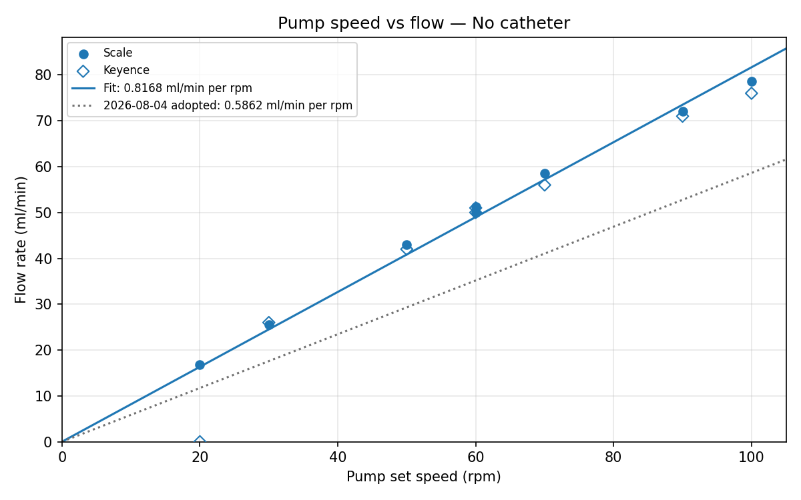
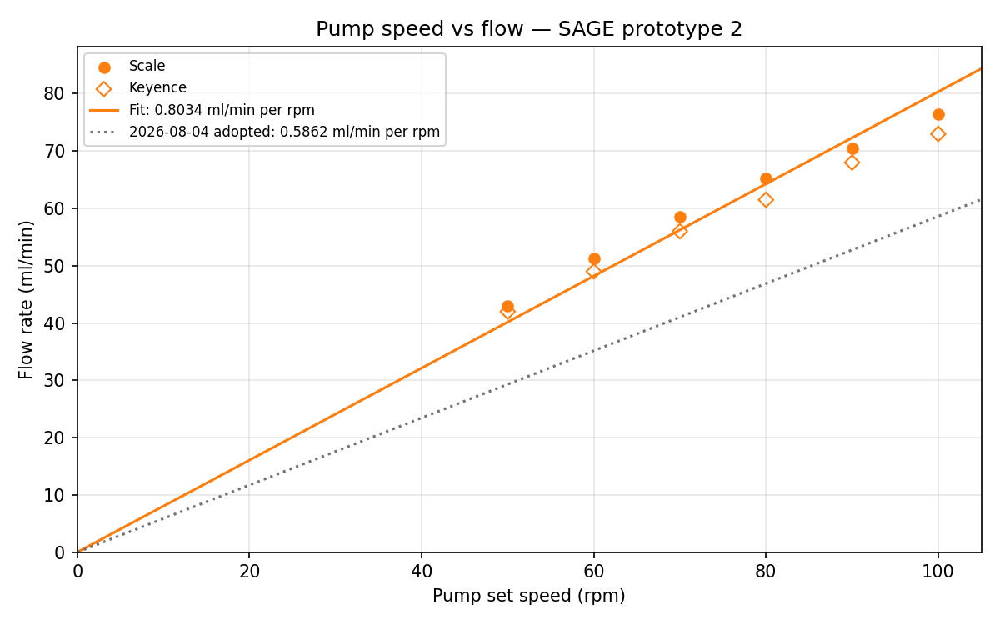

# Pump speed vs flow rate (Tygon PVC pump tubing)

**Date:** 2026-09-14  
**Operator:**  
**Goal:** Characterise peristaltic pump set speed (RPM) against volumetric flow with McMaster Tygon PVC 1/8" ID × 1/4" OD tubing on the pump section. Repeat the same gravimetric + Keyence sweep with SAGE prototype 2 connected.

## Protocol

1. Fit **McMaster Tygon PVC 1/8" ID × 1/4" OD** on the peristaltic-pump section. Fill with water and purge air until flow is steady.
2. Open discharge into a collection vessel on the precision scale. Swipe dry and tare the vessel before each run.
3. Keep the Keyence FD-X in the flow path. Follow the manual instruction (e.g flow showing upwards) and set  display unit (ml/min).
4. **Series A — pump tubing only (no catheter).** For each set speed:
   2. Use the **Run 5.0 min** button form the Service UI
   4. Record **stable Keyence reading (ml/min)** after about 30s
   5. Record collected **mass (g)**.
6. Type each hold into `raw_data/no_catheter.csv` (one row per hold). **Repeat some speeds** on extra rows (same `set rmp`, new mass and Keyence values) to check robustness — do not overwrite the first measurement.
7. **Series B — SAGE prototype 2 connected.** Repeat the same 5 min sweep in `raw_data/sage_prototype_2.csv`, including the same robustness repeats.
8. After the CSVs are filled, run:

```bash
python plot_speed_vs_flow.py
```


## Setup


## Results

```bash
python plot_speed_vs_flow.py
```





Through-origin slopes (scale, 5 min holds):

| Configuration | ml/min per rpm |
|---------------|----------------|
| No catheter | **0.8168** |
| SAGE prototype 2 | **0.8034** |
| 2026-08-04 adopted | 0.5862 |

Raw logs (open the file to see the table; Markdown cannot embed a CSV the way it does a PNG):

- [no_catheter.csv](raw_data/no_catheter.csv)
- [sage_prototype_2.csv](raw_data/sage_prototype_2.csv)

60 rpm was measured twice in the no-catheter run (robustness repeat). Gravimetric flow is \(Q = m / 5\) ml/min.

## Conclusion

- the calculation shoul be updated from x to y
- if the catheder is connected the meassuremensts 
