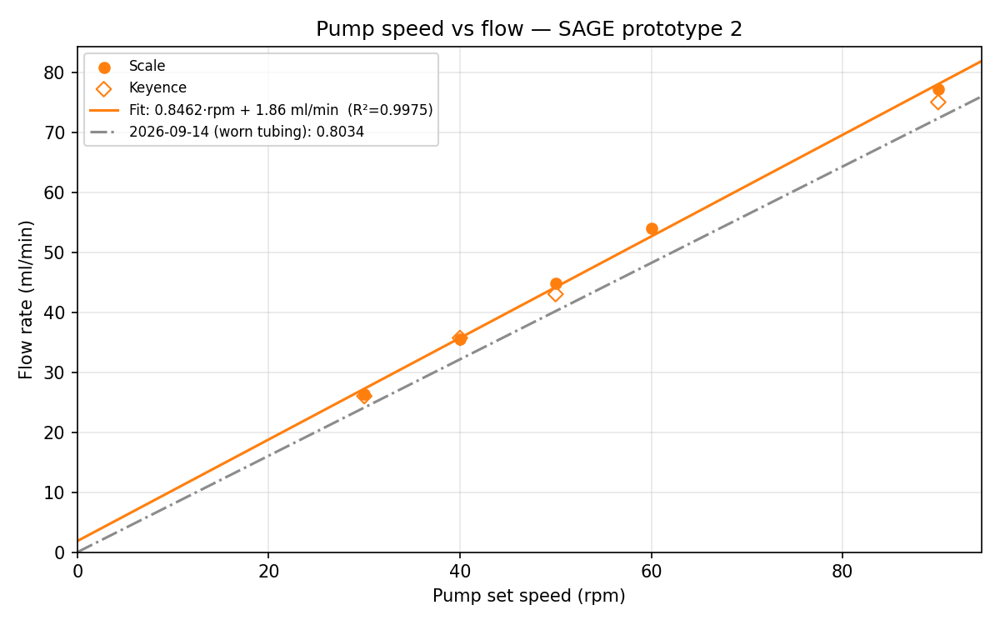
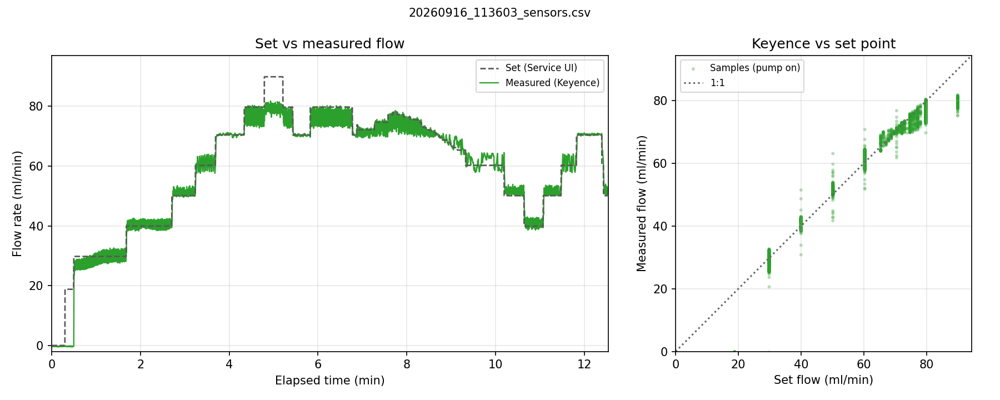

# Pump speed vs flow rate (Tygon PVC, catheter attached)

**Date:** 2026-09-15  
**Operator:**  
**Goal:** Repeat the gravimetric + Keyence pump-speed vs flow characterisation with **new** peristaltic-pump tubing and the **catheter attached only**. Replaces the 2026-09-14 Tygon PVC sweep, which is not accurate because the pump tubing was worn.

## Protocol

1. Replace the worn peristaltic-pump section with **new McMaster Tygon PVC 1/8" ID × 1/4" OD**. Fill with water and purge air until flow is steady.
2. Connect the **catheter** (SAGE prototype 2). No no-catheter series on this run.
3. Open discharge into a collection vessel on the precision scale. Swipe dry and tare the vessel before each run.
4. Keep the Keyence FD-X in the flow path. Follow the manual instruction (e.g. flow showing upwards) and set display unit (ml/min).
5. For each set speed:
   1. Use the **Run 5.0 min** button from the Service UI.
   2. Record **stable Keyence reading (ml/min)** after about 30 s.
   3. Record collected **mass (g)**.
6. Type each hold into `raw_data/sage_prototype_2.csv` (one row per hold). **Repeat some speeds** on extra rows (same `set rmp`, new mass and Keyence values) to check robustness — do not overwrite the first measurement.
7. After the CSV is filled, run:

```bash
python plot_speed_vs_flow.py
python plot_set_measured_flow.py
```

Prefer raw logs named `sensor_log_YYYYMMDD_HHMMSS_<condition>.csv` or `YYYYMMDD_HHMMSS_sensors.csv`. Never hand-edit `raw_data/`; regenerate into `output_data/`.

## Setup

- Peristaltic pump with **new** Tygon PVC 1/8" ID × 1/4" OD on the pump section
- Catheter attached (SAGE prototype 2)
- Keyence FD-X (ml/min)
- Collection vessel on precision scale; 5.0 min timed holds
- Logged: Service UI sensor CSV (`peristaltic_pump_set_speed_rpm`, `pump_flow_ml_per_s` set point, `flow_sensor_ml_per_min` Keyence)

## Results

```bash
python plot_speed_vs_flow.py
```



Adopted fit (scale, 5 min holds, \(Q = m / 5\)):

\[
Q\ [\mathrm{ml/min}] = 0.8462\,\mathrm{rpm} + 1.86
\]

R² = 0.9975, RMSE = 0.87 ml/min. Example: 60 rpm → **52.6 ml/min** (scale 54.0).

| set rpm | mass g | Scale ml/min | Keyence ml/min | Fit ml/min |
|---------|--------|--------------|----------------|------------|
| 30 | 131.5 | 26.30 | 26.0 | 27.24 |
| 40 | 177.6 | 35.52 | 35.7 | 35.70 |
| 50 | 224.0 | 44.80 | 43.0 | 44.16 |
| 60 | 269.8 | 53.96 | — | 52.62 |
| 90 | 385.8 | 77.16 | 75.0 | 78.01 |

Keyence was not recorded at 60 rpm. Where both exist, Keyence is close to the scale (within ~2 ml/min).

Raw gravimetric log: [sage_prototype_2.csv](raw_data/sage_prototype_2.csv)

### Set vs measured (sensor log)

```bash
python plot_set_measured_flow.py
```



Service UI sensor log [20260916_113603_sensors.csv](raw_data/20260916_113603_sensors.csv) (~12.5 min). Set flow is the logged `pump_flow_ml_per_s` (same free-linear conversion as above). Measured is Keyence `flow_sensor_ml_per_min`.

First staircase (hold means):

| set rpm | Set ml/min | Keyence ml/min |
|---------|------------|----------------|
| 20 | 18.8 | ~0 |
| 33 | 29.8 | 28.5 |
| 45 | 39.9 | 40.6 |
| 57 | 50.1 | 50.9 |
| 69 | 60.2 | 60.8 |
| 81 | 70.4 | 70.4 |
| 92 | 79.7 | 76.3 |
| 104 | 89.9 | 79.5 |

At 20 rpm the Keyence stayed at the zero-flow noise floor. From **33–81 rpm** Keyence tracks the set point (typically within ~1 ml/min). Above ~90 rpm measured flow **stops rising with the set point** (104 rpm: set 90 vs measured 80). That is the **catheter limiting the flow** — the lumen / restriction will not pass a higher rate even if the pump is commanded faster.

## Conclusion

- Convert rpm → flow with \(Q = 0.8462\,\mathrm{rpm} + 1.86\) ml/min (new Tygon PVC pump tubing, catheter attached).
- That is more flow than the worn-tubing 2026-09-14 through-origin line (0.8034 ml/min per rpm).
- Keyence agrees with the set point through ~70 ml/min. At higher commands the **catheter does not allow a larger flow rate**; measured flow plateaus (~80 ml/min) while the set point keeps climbing.
