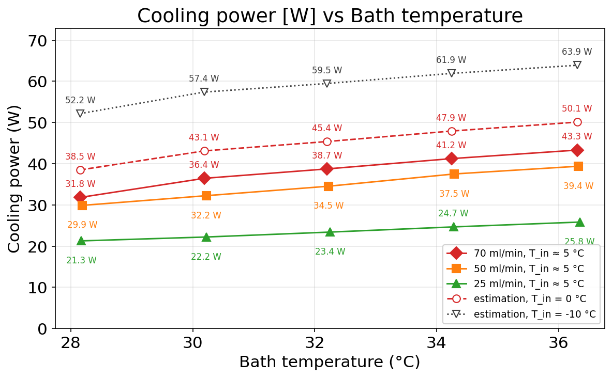
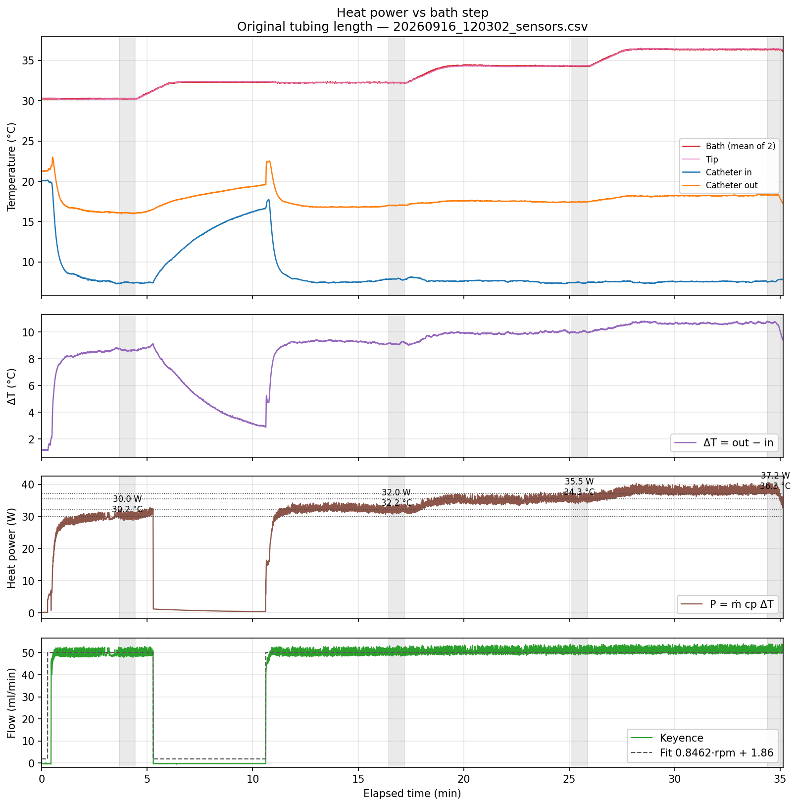
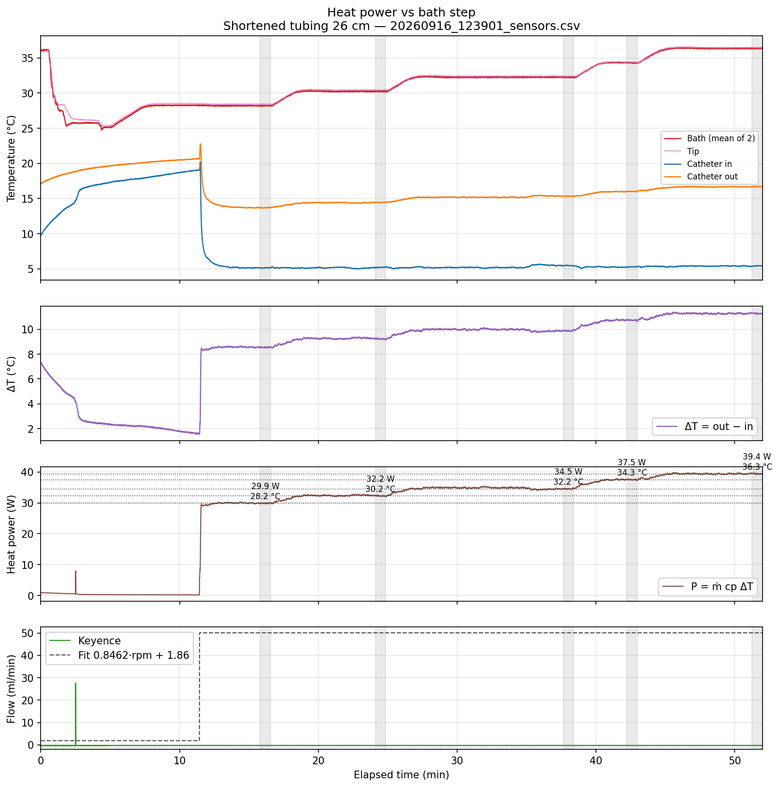

# Heat capacity characterisation of the catheter

**Date:** 2026-09-16  
**Operator:**  
**Goal:** Characterise the catheter heat pickup: P-power and UA-Thermal Conductance (The combined capacity of the equipment to transfer heat per degree of temperature difference), and response speed from inlet and outlet temperatures at constant flow.

Note: temp probes Plate 1, Plate 2, Body Temp and Probe 4 were not connected.

## Protocol

1. Use tubing lengths matching the final product, then repeat with a shortened pump-to-catheter line.
2. Replace the cartridge with a container of ice water.
3. Place the catheter in a controlled-temperature bath. Mix the bath and measure it with two sensors.
4. Pump at a constant **~50 ml/min** (57 rpm on these runs).
5. Step the bath from **30 to 36 °C**. The logs actually hold at **~30, 32, 34, 36 °C** (2 °C), plus a 28 °C pre-hold on the shortened run.
6. Log catheter **input** and **output** temperature. From the settled tails, calculate heat power and UA.

Prefer raw logs named `sensor_log_YYYYMMDD_HHMMSS_<condition>.csv`. Never hand-edit `raw_data/`; regenerate into `output_data/`.

## Setup


Runs:

- **Original tubing** — sensors on the existing product-length line. Keyence connected. Raw: [20260916_120302_sensors.csv](raw_data/20260916_120302_sensors.csv)
- **26 cm tubing** — pump-to-catheter line cut to 26 cm. **Keyence was not connected**; flow is from the rpm fit. Raw: [20260916_123901_sensors.csv](raw_data/20260916_123901_sensors.csv)

## Heat power calculation

Heat picked up by the coolant:

```
P = ṁ · c_p · (T_out − T_in)
```

with **c_p = 4186 J/(kg·K)** and **1 ml = 0.001 kg**. In the analysis script:

```text
ṁ = (flow_ml_min / 60) * 0.001
P       = ṁ * 4186 * (T_out - T_in)
```

T_in, T_out, and flow are means over the last **45 s** of each bath plateau.

Worked example (26 cm, 36.3 °C hold):

```
ΔT = T_out − T_in
   = 16.69 − 5.42
   = 11.27 °C

Q  = 50.09 ml/min

ṁ  = (Q / 60) × 0.001
   = (50.09 / 60) × 0.001
   = 0.8348 × 0.001
   = 8.35 × 10⁻⁴ kg/s

P  = ṁ × c_p × ΔT
   = (8.35 × 10⁻⁴) × 4186 × 11.27
   = 39.4 W
```

Heat-transfer capacity **UA = P / LMTD**. LMTD is the log-mean temperature difference: the driving gap between bath and coolant, accounting for the coolant warming as it flows. The bath is treated as a constant-temperature source:

```
ΔT_in  = T_bath − T_in
ΔT_out = T_bath − T_out
LMTD   = (ΔT_in − ΔT_out) / ln(ΔT_in / ΔT_out)
UA     = P / LMTD
```

## Results

```bash
python analyze_heat_power.py
```





| Bath °C | T_in °C | T_out °C | ΔT °C | Q ml/min | P W | UA W/K | ε |
|--------:|--------:|---------:|------:|---------:|----:|-------:|--:|
| 30.22 | 7.45 | 16.08 | 8.64 | 49.7 | 30.0 | 1.65 | 0.38 |
| 32.24 | 7.88 | 17.02 | 9.15 | 50.2 | 32.0 | 1.65 | 0.38 |
| 34.29 | 7.44 | 17.44 | 10.00 | 50.8 | 35.5 | 1.65 | 0.37 |
| 36.33 | 7.68 | 18.13 | 10.46 | 51.1 | 37.2 | 1.62 | 0.36 |

Flow-on settle of the first 30 °C pulse: **78 s** to 5% of steady ΔT.



Keyence was not connected on this run; Q is from the rpm fit (50.1 ml/min at 57 rpm).

| Bath °C | T_in °C | T_out °C | ΔT °C | Q ml/min | P W | UA W/K | ε |
|--------:|--------:|---------:|------:|---------:|----:|-------:|--:|
| 28.19 | 5.14 | 13.69 | 8.55 | 50.1 | 29.9 | 1.62 | 0.37 |
| 30.22 | 5.22 | 14.44 | 9.22 | 50.1 | 32.2 | 1.61 | 0.37 |
| 32.23 | 5.46 | 15.34 | 9.88 | 50.1 | 34.5 | 1.61 | 0.37 |
| 34.29 | 5.28 | 16.01 | 10.73 | 50.1 | 37.5 | 1.61 | 0.37 |
| 36.33 | 5.42 | 16.69 | 11.27 | 50.1 | 39.4 | 1.58 | 0.36 |

Table: [heat_power_by_bath_step.csv](output_data/heat_power_by_bath_step.csv)


## Conclusion

- At ~50 ml/min the catheter picks up **30–39 W** over the 30–36 °C bath range. Power rises with bath temperature; **UA stays ~1.61–1.65 W/K** (effectiveness ~0.37).
- Cutting the pump-to-catheter line to **26 cm** makes the inlet ~2.3 °C colder and raises power **6–8%** at the same bath temperature. UA does not increase, so the extra power is less inlet-line warming, not a change in the catheter.
