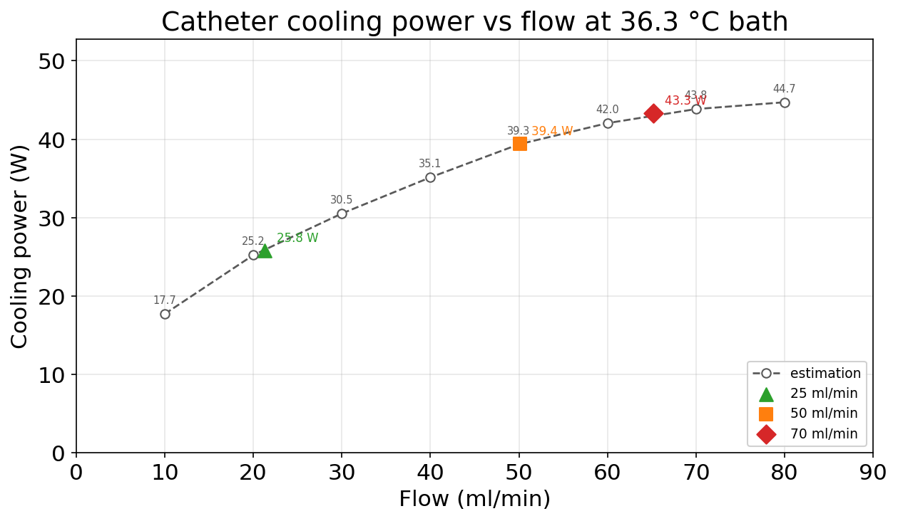

# Heat capacity characterisation of the catheter

**Date:** 2026-09-16, 2026-09-18, 2026-09-21  
**Operator:**  
**Goal:** Characterise the catheter heat pickup: P-power and UA-Thermal Conductance (The combined capacity of the equipment to transfer heat per degree of temperature difference), and response speed from inlet and outlet temperatures at constant flow.

Note: temp probes Plate 1, Plate 2, Body Temp and Probe 4 were not connected.

## Protocol

1. Use tubing lengths matching the final product, then repeat with a shortened pump-to-catheter line.
2. Replace the cartridge with a container of ice water.
3. Place the catheter in a controlled-temperature bath. Mix the bath and measure it with two sensors.
4. Pump at a constant **~50 ml/min** (57 rpm), then repeat at **27 rpm (~22 ml/min)** and **81 rpm (~70 ml/min)**.
5. Step the bath from **30 to 36 °C**. The logs actually hold at **~30, 32, 34, 36 °C** (2 °C), plus a 28 °C pre-hold on the shortened and 27 rpm runs.
6. Log catheter **input** and **output** temperature. From the settled tails, calculate heat power and UA.

Prefer raw logs named `sensor_log_YYYYMMDD_HHMMSS_<condition>.csv`. Never hand-edit `raw_data/`; regenerate into `output_data/`.

## Setup


Runs:

- **Original tubing, ~50 ml/min** — product-length line, 57 rpm, Keyence connected. Raw: [20260916_120302_sensors_50mlmin_original_tubing.csv](raw_data/20260916_120302_sensors_50mlmin_original_tubing.csv)
- **26 cm tubing, ~50 ml/min** — pump-to-catheter line cut to 26 cm, 57 rpm. **Keyence was not connected**; flow is from the rpm fit. Raw: [20260916_123901_sensors_50mlmin_26cm.csv](raw_data/20260916_123901_sensors_50mlmin_26cm.csv)
- **26 cm tubing, ~22 ml/min** — same bath steps at 27 rpm. Keyence connected. Inlet ~5.6 °C, matching the 26 cm ~50 ml/min run. Raw: [20260918_142602_sensors_22mlmin.csv](raw_data/20260918_142602_sensors_22mlmin.csv)
- **26 cm tubing, ~70 ml/min** — same bath steps at 81 rpm. Keyence connected. Inlet ~4.5 °C. Raw: [20260921_093450_sensors_70mlmin.csv](raw_data/20260921_093450_sensors_70mlmin.csv)
- **Other catheter, ~50 ml/min** — different catheter, 57 rpm, Keyence connected. Raw: [20260921_101547_sensors_50mlmin_other_catheter.csv](raw_data/20260921_101547_sensors_50mlmin_other_catheter.csv)

## Heat power calculation

Heat picked up by the coolant:

```
P = ṁ · c_p · (T_out − T_in)
```

with **c_p = 4186 J/(kg·K)** and **1 ml = 0.001 kg**. In the analysis script:

```text
ṁ = (flow_ml_min / 60) * 0.001
P       = ṁ * 4186 * (T_out - T_in)
```

T_in, T_out, and flow are means over the last **45 s** of each bath plateau.

Worked example (26 cm, 36.3 °C hold):

```
ΔT = T_out − T_in
   = 16.69 − 5.42
   = 11.27 °C

Q  = 50.09 ml/min

ṁ  = (Q / 60) × 0.001
   = (50.09 / 60) × 0.001
   = 0.8348 × 0.001
   = 8.35 × 10⁻⁴ kg/s

P  = ṁ × c_p × ΔT
   = (8.35 × 10⁻⁴) × 4186 × 11.27
   = 39.4 W
```

Heat-transfer capacity **UA = P / LMTD**. LMTD is the log-mean temperature difference: the driving gap between bath and coolant, accounting for the coolant warming as it flows. The bath is treated as a constant-temperature source:

```
ΔT_in  = T_bath − T_in
ΔT_out = T_bath − T_out
LMTD   = (ΔT_in − ΔT_out) / ln(ΔT_in / ΔT_out)
UA     = P / LMTD
```

## Results

```bash
python analyze_heat_power.py
```

### 26 cm tubing (22 / 50 / 70 ml/min)




Predicted P is interpolated every **10 ml/min** from the 22 / 50 / 70 ml/min holds at 36 °C.


Catheter out − catheter in at the 28 / 30 / 32 / 34 / 36 °C holds (26 cm tubing, last 45 s). Lower flow gives a larger rise; all three flows rise with bath temperature.

| Bath °C | ~22 ml/min ΔT °C | ~50 ml/min ΔT °C | ~70 ml/min ΔT °C |
|--------:|-----------------:|-----------------:|-----------------:|
| 28 | 13.22 | 8.55 | 6.84 |
| 30 | 14.26 | 9.22 | 7.88 |
| 32 | 15.27 | 9.88 | 8.40 |
| 34 | 16.28 | 10.73 | 8.99 |
| 36 | 17.38 | 11.27 | 9.53 |

```
P = ṁ · c_p · (T_bath − T_in) · (1 − exp(−UA / (ṁ · c_p)))
```


Keyence was not connected on this run; Q is from the rpm fit (50.1 ml/min at 57 rpm).

| Bath °C | T_in °C | T_out °C | ΔT °C | Q ml/min | P W | UA W/K | ε |
|--------:|--------:|---------:|------:|---------:|----:|-------:|--:|
| 28.19 | 5.14 | 13.69 | 8.55 | 50.1 | 29.9 | 1.62 | 0.37 |
| 30.22 | 5.22 | 14.44 | 9.22 | 50.1 | 32.2 | 1.61 | 0.37 |
| 32.23 | 5.46 | 15.34 | 9.88 | 50.1 | 34.5 | 1.61 | 0.37 |
| 34.29 | 5.28 | 16.01 | 10.73 | 50.1 | 37.5 | 1.61 | 0.37 |
| 36.33 | 5.42 | 16.69 | 11.27 | 50.1 | 39.4 | 1.58 | 0.36 |


Original catheter (product-length and 26 cm tubing) vs a different catheter, all at ~50 ml/min.

## Conclusion

- At ~50 ml/min the catheter picks up **30–39 W** over the 30–36 °C bath range. Power rises with bath temperature; **UA stays ~1.61–1.65 W/K** (effectiveness ~0.37).
- Cutting the pump-to-catheter line to **26 cm** makes the inlet ~2.3 °C colder and raises power **6–8%** at the same bath temperature. UA does not increase, so the extra power is less inlet-line warming, not a change in the catheter.
- At **~22 ml/min** (27 rpm, 26 cm line) power falls to **21–26 W**. ΔT and effectiveness rise (~0.57); UA drops to **1.26–1.41 W/K**.
- At **~70 ml/min** (81 rpm, Keyence 65–67 ml/min) power rises to **32–43 W**. ΔT and effectiveness fall (~0.30); UA stays **~1.60–1.69 W/K**, similar to the 50 ml/min 26 cm run.
- Across the 28–36 °C holds, catheter out − in is **13.2–17.4 °C** at ~22 ml/min, **8.6–11.3 °C** at ~50 ml/min, and **6.8–9.5 °C** at ~70 ml/min. Higher flow shortens residence time, so the coolant rises less even though power is higher.
- A **different catheter** at ~50 ml/min (Keyence 46–48 ml/min) picks up only **19–26 W**, with UA **~0.91–0.96 W/K** — well below the first catheter at the same pump speed.
